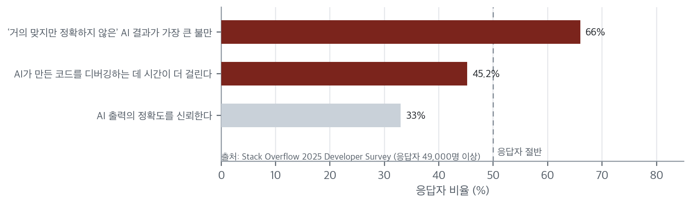
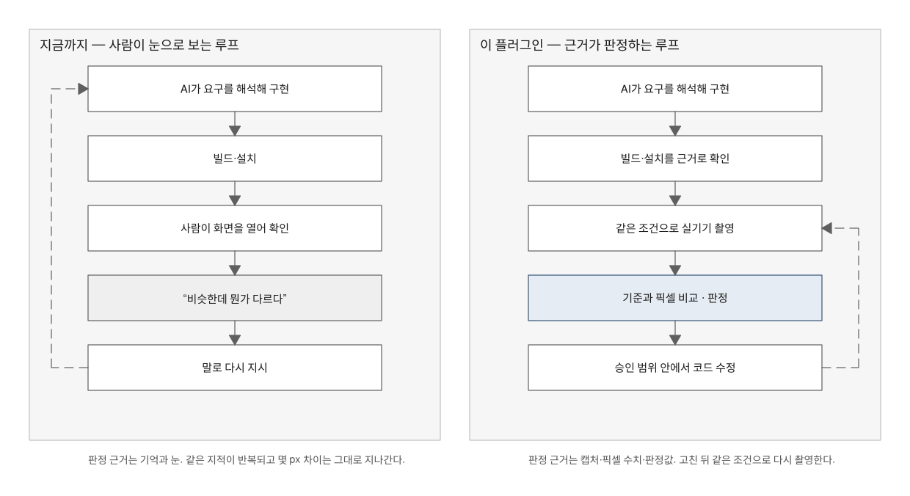
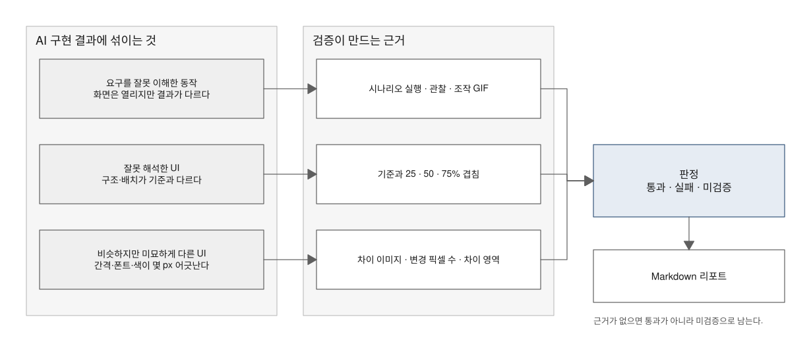
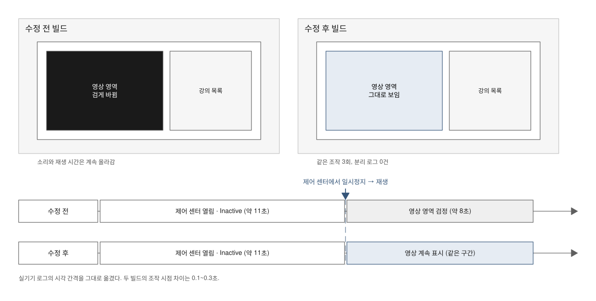

# Mobile QA

Author: JunyoungJung · 2026-10-27 · Version: 0.3.0

[한국어](README.md)

Mobile QA replaces eyeballing AI-generated screens with a loop that judges them from physical-device, iOS Simulator, or Android Emulator captures and pixel metrics.

A macOS plugin for Codex and Claude Code. It interacts with the app on the specified physical device, iOS Simulator, or Android Emulator, compares what it captures against a baseline pixel by pixel, fixes code within the scope you allow, recaptures under the same conditions, and writes the whole thing up as a Markdown report. Simulator QA can use existing UI tests or available screen-control tools with `simctl` capture, without `agent-device`. [1], [2], [3]

The plugin adds no MCP server, lifecycle hook, remote model service, telemetry, or bundled SDK/binary.


## Tool selection by role

Apply the [iOS Simulator, Android Emulator, and Flutter routing policy](skills/mobile-device-qa/references/tool-selection.md). Use `simctl` with installed `xcui`/AXe or host-provided CUA for iOS exploration and capture, and [Android CLI](https://developer.android.com/tools/agents/android-cli) with ADB for Android Emulator. Reuse existing regression tests first; add [Maestro](https://docs.maestro.dev/get-started/supported-platform/flutter) for shared flows and [Patrol](https://patrol.leancode.co/documentation/native/overview) when Flutter needs OS or native-screen interactions. Keep original-PNG comparison and Markdown/GIF reports independent of the interaction tool.

## Why this exists

Hand a screen to an AI assistant and what usually comes back is *almost right*. The list renders but the filter condition is inverted; the card looks like the design but the spacing is off by a few pixels; the button sits where it should but does something else when tapped. It compiles and it opens, so builds and unit tests do not catch any of it. What remains is a person holding a device, opening screens one by one, comparing them against a remembered baseline, and describing "something looks off" well enough to ask for another attempt.

That loop is a measured cost, not a feeling. Chart 1 shows the AI section of the 2025 Stack Overflow Developer Survey, answered by more than 49,000 developers. [4]



*Chart 1. Developer responses about AI tools (Stack Overflow 2025)*

Other public studies in Table 1 point the same way.

*Table 1. Public studies on the review cost of AI-written code*

| Study | What it measured | Result |
|---|---|---|
| Stack Overflow 2025 survey (49,000+ respondents) [4] | Top frustration when using AI tools | 66% chose "AI solutions that are almost right, but not quite"; 45.2% said debugging AI-generated code takes more time |
| METR randomized controlled trial (16 experienced open-source developers, 246 real issues) [5] | Completion time with AI allowed versus disallowed | Tasks took 19% longer with AI allowed; the same developers believed AI had made them 20% faster |
| GitClear 2025 (211 million changed lines, 2020–2024) [6] | Duplication and refactoring trends | Eightfold rise in duplicated blocks of five or more lines during 2024; moved lines down 39.9% |
| DORA 2025 (~5,000 technology professionals) [7] | AI adoption and delivery stability | Throughput rose, but change failures, rework, and time to restore rose with it |

The important part of the METR result is not the 19%. It is that the perception ran the other way: the same developers felt faster while measurably getting slower. "I looked at it myself" is therefore not, on its own, evidence of a pass.

Figure 1 places both loops side by side with the same number of steps. The steps do not shrink — the **basis for the verdict** changes.



*Figure 1. Manual review loop versus evidence-based verification loop*

## What produces a verdict

Each kind of mismatch surfaces through different evidence: behavioral drift through real interaction and observation, structural drift through overlays against the baseline, and a few pixels of drift through diff images and pixel counts. The plugin produces that evidence and records it with the verdict in a Markdown report. [1], [2]



*Figure 2. Kinds of mismatch and the evidence that surfaces each*

Without evidence, nothing is reported as a pass. If another task holds the device, the screen is protected from capture, or the installed build cannot be confirmed, the item stays `unverified` or `preparation required`. Two images of different size or state are never auto-scaled or auto-aligned into agreement; the conditions are restored and the screen is captured again. [2]

Code fixes happen **only inside the scope the user authorized**, and after a fix the same baseline is recaptured so the first before-image and the final build sit side by side. What closes the loop is a new capture, not the assistant's own account of its work. [1]

## Case 1. A black screen that resisted reproduction for a year

An iPad learning app had collected 8 reports of "audio plays but the video area is black" and 26 reports of "playback stops about a second after it starts." Reinstalling did not help, and the web player and other apps were fine. Builds passed. Tests passed. The cause was that the player treated **a state where the app is visible but receives no events** (`UIApplicationState.inactive`) exactly like the background, a judgment five commits had widened little by little over eighteen months.

Reproduction was hard because the conditions stacked. Background playback has to be on; Control Center has to be open so the app goes `Inactive`; and in that state the user has to hit pause and then play in the Now Playing widget. The simulator has no Control Center, and watching the screen by eye leaves nothing behind except the symptom itself.

Once the four reproduction steps were pinned down, the rest was the loop. The before-fix build was produced by reverting only the four changes in the same working tree (restored afterwards and checked with a diff), both builds carried the same diagnostic logging, and the same device performed the same interaction for both recordings. Figure 3 shows those two recordings.



*Figure 3. Before and after in case 1 (real-device recordings and logs redrawn as shapes)*

Table 2 lists everything that was checked.

*Table 2. Real-device results from case 1*

| Check | Build · device | Observation | Verdict |
|---|---|---|---|
| Reproduction steps | Before fix · iPad 8th gen | Video layer detached right after playback resumed; audio only | Reproduced (unattended automation) |
| Reproduction steps | Before fix · iPad Pro 11 (M5) | Black video area for about 8 seconds, until Control Center closed | Reproduced (recorded) |
| Same steps, three times | After fix · iPad Pro 11 (M5) | No detach log in any run; video stayed visible | Pass (recorded) |
| App switch (PiP path) | After fix · iPad Pro 11 (M5) | PiP started about 0.15 s after resign; no detach | Pass |
| Background entry without PiP | — | Not executed | Unverified |
| One-second repeated pause | — | The state could not be produced even on the before-fix build | Unverified |

The point of the table is the two rows that stayed `unverified`. The fix touched four call sites, but one of those paths was never walked on a real device, and the symptom behind 26 of the reports could not be reproduced even on the unfixed build. Instead of promoting either to a pass, the report recorded what is still unknown, and closed only the reproduced half with before/after recordings and logs.

Under a loop judged by eye, this bug stayed "it happens sometimes" for nearly a year. What changed was not a smarter tool. It was pinning the conditions, capturing the same screen twice, and keeping the difference.

This case summarizes an internal fix report from a private repository; the recordings and source are not included here.

## Case 2. Telling whether your own change broke it

After a package restructure and a change to how playback input is ordered, a regression pass ran. Ten items passed and two failed. That pass, however, **made no regression judgment at all.** It stated plainly in the report that without running the same interactions on the pre-change build, there was no way to tell whether these failures came from this change or had always been there.

Stopping there leaves "do I fix this?" unanswered, because standing up the old build on the same device, account, and content is a chore. Every overwrite install drops the login session, and without an untracked local configuration file the first build halts on a settings error. One of the failures also only showed up about half the time, which is exactly the kind of thing a few manual taps will fail to surface.

The second run built the commit immediately before the change in a separate working folder and kept both builds on hand. Which one was running was pinned by the executable hash, and each overwrite install was followed by a fresh login to the same account. Then the same gesture, at the same coordinates and duration, was repeated on both.

*Table 3. The same interaction repeated on both builds*

| Failure from the first pass | Post-change build | Pre-change build | Verdict |
|---|---|---|---|
| Network error after dragging far along the timeline (1 of 2 in the first pass) | Two coordinates × 5 runs, 0 errors | Two coordinates × 5 runs, 0 errors | Reproduced on neither build. No evidence linking it to the change |
| "End" button in section repeat does nothing | Unresponsive across five different tap methods | Identical | Present before the change |

Both were "failures," but one of them was not this work's problem. The repetition also exposed a condition: the controls auto-hide after about three seconds, and a tap before that lands as a visibility toggle rather than a button press. Results only stabilized once a four-second wait preceded each run. By hand, that condition reads as "sometimes the button doesn't take."

## Case 3. Finding a cause that is not on screen

All three paths in a share bar failed. Two messengers showed "install the app" even though both apps were plainly installed, and the SMS path showed "unsupported URL." Reinstalling did not help, and neither did another device.

The only information left on screen is that notice. Nothing about it says whether the three share one cause or have three, and nothing contradicts the app's own claim that the app is missing. Guesses from this position tend to drift toward the install state or the server.

Repeating the same interaction with a real-device console attached split the cause across three log lines.

*Table 4. What the screen showed and what the console said*

| Path | Screen | Console |
|---|---|---|
| Messenger A share | "install the app" | `not allowed to query for scheme` — 55th of 58 queryable schemes, past the platform limit of 50, so it was cut off |
| Messenger B share | Same notice, then a store page after about 5 seconds | Same limit overrun. The navigation is the web SDK's fallback |
| Send SMS | "unsupported URL" | `-1002`. The external-scheme check only consults that list, misses `sms`, and the WebView tries to load it directly |

The limit itself was cross-checked against the platform's own documentation. After the fix, all three paths were opened again on the same device and passed, and the two pre-fix log lines were confirmed to be **entirely absent** from the final run log. Each item was also checked through the accessibility tree to confirm zero leftover error notices.

The re-verification run turned up one more defect: on the first fix attempt, cancelling the system confirmation dialog still produced "install the app." That was fixed and passed too. One thing was deliberately left outside the scope — while the dialog is up, the web SDK moves the view to a store page, which is not this codebase's behavior, so it was recorded as a remaining issue.

## Case 4. "Success" versus something actually happening

Adding a favorite left the in-progress indicator on screen, and every request after it was rejected. The cause was that the SDK's callback is not a write result but **a notification that the list was re-read**. Code assuming that callback arrives per write waits forever whenever a write is accepted and no notification follows.

This is hard to catch because every signal says success. The SDK reports that it accepted the request, the log shows no failure, and the screen merely looks slow. Confirming it means running the whole flow on a real device — add, leave the screen, come back, delete one, come back again — and restoring the data created each time.

*Table 5. Running the full flow*

| What was checked | Result |
|---|---|
| Add → add again → re-enter → delete one → delete the rest → re-enter | All six steps passed. The two items created for the check were restored to zero |
| Momentary completion toast and precise reflection time | Unverified — capture latency. Still frames were not stitched together to stand in for continuous motion |
| Renaming a label | Unverified — the text input connection never recovered |

At one point the control tool returned a connection error, yet the item was already on screen. The command was not re-sent; the result was confirmed from the screen instead. **A tool failing and an app failing are different events**, and re-sending would have created a duplicate.

The report also stated the boundary of success: "success here means the request was accepted and the list was reflected; it guarantees neither the SDK's internal async work nor the server finishing its write." Claiming only as much as was checked is part of the result.

What these four cases have in common is not a skill gap. It is where the evidence lives. One console line, two builds side by side, one full flow repeated ten times, the same screen captured twice under matched conditions — all doable, none worth doing by hand every time, so they get skipped. The loop does them every time.

## Workflows built with agent-device

`agent-device` is a separately installed tool for device interaction, inspection, and evidence collection. **Mobile QA connects those capabilities to project-specific conditions, verdicts, verification after fixes, reusable flows, and reports.** The table separates upstream capabilities from the workflows this plugin assembles. [1], [2], [8]

| What agent-device provides | Workflow Mobile QA adds | What you receive |
|---|---|---|
| UI inspection, taps, text entry, scrolling, waits, and assertions (`snapshot`, `press`, `fill`, `wait`, `is`) | Find targets on the current screen and verify the expected state after each action | Per-item expectations, observations, verdicts, and screenshots |
| App launch, deep links, home navigation, rotation, and system alerts (`open`, `home`, `orientation`, `alert`) | Check entry, return, rotation, and permission-dialog flows where supported | Observations for each condition and the failing step |
| Screenshots and recordings (`screenshot`, `record`) | Capture under matching conditions, compare against an existing app or Figma with a separate image tool, then fix authorized code and recapture | Overlays, diffs, pixel metrics, and first-before versus final-after evidence |
| Logs, network information, and performance artifacts (`logs`, `network`, `perf`, `trace`) | Connect reproduction steps to runtime evidence; check performance with dedicated metrics | Reproduction steps, logs or measurements, and the verified and unverified scope |
| Batches, replays, and test suites (`batch`, `replay`, `test`) | Reuse verified flows and check before/after builds under the same conditions | Repeated-run results, failing steps, and executable flows with reuse conditions |
| Device/session selection and capability discovery (`devices`, `session`, `capabilities`) | Bind the project, installed build, and device; reuse sessions and hand over control | Evidence tying observations to the stated build and device |

The plugin's Python tool performs image comparison; a connected Figma tool exports the baseline. The separate `test-accounts` skill handles account lookup and secret entry: passwords do not go into ordinary `fill` commands or replays. The host agent edits and builds source through the project's procedures, and supported tools install the prepared app. `agent-device` itself does not edit or build source. [2], [3]

Functional QA needs no Figma. An authenticated session needs no account helper, and comparing two supplied PNGs needs neither a device nor `agent-device`. The [operations reference](docs/operations.en.md#agent-device-capabilities-and-plugin-responsibilities) explains the commands and six workflows in detail.

**iOS Simulator QA is also supported.** Follow the [Simulator procedure](skills/mobile-device-qa/references/simulator.md) to capture original PNGs and video with `simctl`, then use the existing comparison tool for design review and a Markdown report. If no automated UI-control path is available, request only the necessary screen navigation and continue capture, comparison, and reporting. Keep Simulator findings separate from physical-device results.

## What it cannot do

- **Independently verify physical audio, vibration, or connections.** Speaker/headphone output and cable insertion need a person or separate equipment. `audio probe` covers browser or host-rendered simulator/emulator audio.
- **Capture every request, change responses, or establish server persistence on its own.** `network` reads HTTP(S) entries in app logs. Missing traffic, response manipulation, and server writes need a proxy, test server, read-back, or other evidence.
- **Bypass OS security or DRM, or reproduce every system prompt.** Protected video may capture as black, and XCTest can automatically grant pasteboard access, preventing a test of the iOS permission dialog.
- **Establish performance or complete correctness from images and video.** Recording FPS is not app rendering performance. A verdict does not extend to unseen states, devices, or internal processing, and intermittent bugs are not guaranteed to reproduce.
- **Support every upstream target equally.** This plugin's QA workflows cover physical iPhones, iPads, Android devices, iOS Simulator, and Android Emulator. Flutter follows its target platform's workflow. It does not adopt the full upstream macOS, TV, web, remote, or Maestro syntax scope, and Simulator results do not establish physical-device behavior.

The [operations reference](docs/operations.en.md#limits-and-checks-that-need-other-evidence) separates these limits from checks that need other tools. A supported command is not a verified result on a particular device. [1], [8]

Combining tools can extend preparation and observation. The [workflow candidates](docs/workflow-extensions.en.md) start with **Mac Computer Use sends an AirDrop image → verify arrival → agent-device imports it in the app**, then cover USB preparation, web/mobile synchronization, real push, network faults, QR/OCR, audio, and updates. Each includes prerequisites, evidence boundaries, and cleanup; these combinations are not yet real-device-verified plugin flows.

## Getting started

Install the plugin in the host you use.

```bash
# Codex
codex plugin marketplace add https://github.com/Jimmy-Jung/mobile-qa.git
codex plugin add mobile-qa@mobile-qa-marketplace
```

```bash
# Claude Code
claude plugin marketplace add Jimmy-Jung/mobile-qa
claude plugin install mobile-qa@mobile-qa-marketplace --scope user
```

Run `setup` once to pick the folder where results are kept — `/mobile-qa:setup` in Claude Code, the installed setup skill in Codex. Any existing folder works, internal or external; later runs verify and reuse the same one.

After that, name the project, the device, and what to check.

> Use mobile-device-qa on this checkout and the connected Android test device. Keep the existing session. Check that the selected filter survives opening an item and returning to the list. Put the per-item results, screenshots, and a short interaction GIF in a Markdown report.

> Use mobile-device-qa on the specified iOS Simulator without agent-device. Use available UI tests or screen control with simctl capture, compare the app against Figma, and write a Markdown report with screenshots, overlays, differences, and an interaction GIF. Request only necessary direct login input and state what was verified on Simulator.

> Review the new build on the specified iPhone against the attached Figma frame. Capture at the same size, scale, theme, fonts, and content, and find mismatches through overlays and a diff image. Fix the relevant UI code, rebuild, and recapture under the same conditions.

More examples and the full prerequisites are in the [operations reference](docs/operations.en.md).

## What you get

One report (`report.md`) and the images and GIFs it references. Nothing else is needed to read it; move the report and its attachments together. A design review additionally produces overlays, a diff image, and a comparison file with the pixel metrics.

There are four verdicts.

- `pass` — the expected behavior was confirmed from evidence on the stated device and build.
- `fail` — an observation that differs from the expectation, with its evidence.
- `unverified` — not enough was run or observed. The reason and the next check are recorded.
- `preparation required` — a tool, build, permission, or screen condition has to come first.

Brightness in an overlay or the area of a diff region is not treated as a cause on its own. Two images of different size or state are never scaled or aligned into agreement; the conditions are restored and the screen is captured again. The [example report](examples/design-review/report.md) shows the file names and metrics against real output.

## Further reading

| Document | Use it for |
|---|---|
| [Operations reference](docs/operations.en.md) | agent-device capabilities, workflows and limits; prerequisites, install, metrics, and release steps |
| [Workflow candidates](docs/workflow-extensions.en.md) | Combining AirDrop, Computer Use, APIs, and equipment to supplement a single tool's limits |
| [Example report](examples/design-review/report.md) | Seeing what the deliverable actually looks like |
| [Device QA skill](skills/mobile-device-qa/SKILL.md) | The verification rules the agent follows |
| [Simulator QA](skills/mobile-device-qa/references/simulator.md) | Interacting with and capturing iOS Simulator, reviewing designs, and reporting without agent-device |
| [Test accounts skill](skills/test-accounts/SKILL.md) | Account storage and the login procedure |
| [Security](SECURITY.md) | How far secrets are protected, and how to report issues |

Original plugin code is MIT; upstream notices are kept in [THIRD_PARTY_NOTICES.md](THIRD_PARTY_NOTICES.md).

## References

[1] Mobile QA, [Device QA skill](skills/mobile-device-qa/SKILL.md), local workflow contract. Defines scope, evidence, recovery, report defaults, and final judgment.

[2] Mobile QA, [Design-review procedure](skills/mobile-device-qa/references/design-review.md) and [comparison helper](skills/mobile-device-qa/scripts/compare_screenshots.py), local contract and implementation. Defines PNG input handling, comparison metrics, masking, and recapture.

[3] Mobile QA, [Test-account skill](skills/test-accounts/SKILL.md), local contract. Defines plaintext storage, profile trust, cleanup, version pinning, and signing requirements.

The external studies were checked on 2026-10-23. Figures from [4] and [5] were read from the primary sources. Figures from [6] and [7] come from public coverage and summary pages, because the full reports sit behind a purchase or registration form.

[4] Stack Overflow, [2025 Developer Survey — AI](https://survey.stackoverflow.co/2025/ai), primary source. Frustration and trust response rates among 49,000+ developers.

[5] METR, [Measuring the Impact of Early-2025 AI on Experienced Open-Source Developer Productivity](https://metr.org/blog/2025-07-10-early-2025-ai-experienced-os-dev-study/), primary source. Completion time and perception gap across 16 developers and 246 issues.

[6] GitClear, [AI Copilot Code Quality: 2025 Look Back at 12 Months of Data](https://www.gitclear.com/ai_assistant_code_quality_2025_research), vendor report. Duplication and moved-line trends across 211 million changed lines.

[7] Google Research, [DORA 2025 State of AI-assisted Software Development Report](https://research.google/pubs/dora-2025-state-of-ai-assisted-software-development-report/), industry report. Relationship between AI adoption, throughput, and instability.

[8] Callstack, [Commands](https://oss.callstack.com/agent-device/docs/commands), [Debugging & Profiling](https://oss.callstack.com/agent-device/docs/debugging-profiling), [Known Limitations](https://oss.callstack.com/agent-device/docs/known-limitations), and [Run Maestro flows](https://oss.callstack.com/agent-device/docs/run-maestro-flows). Official documentation checked on 2026-10-23 against the installed CLI 0.21.30 help. Command support is not evidence of a real-device run.
