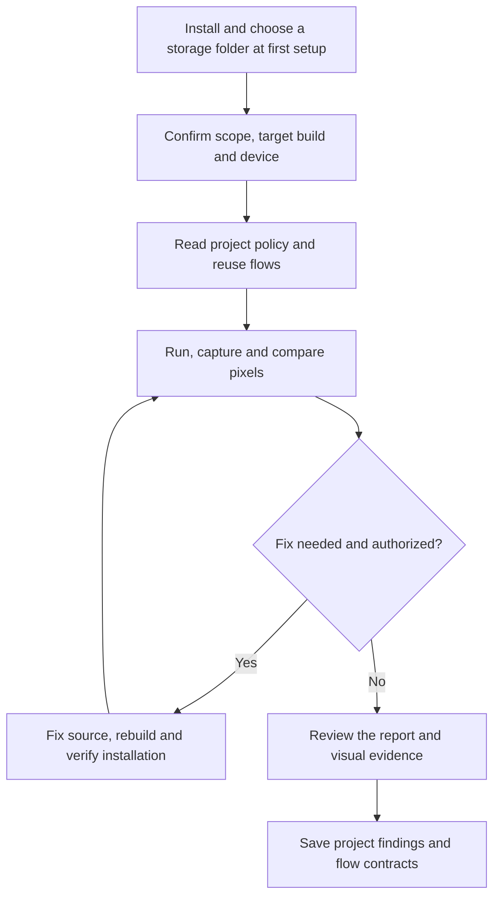

# Mobile QA

Author: JunyoungJung · 2026-10-23 · Version: 0.2.0

[한국어](README.md)

Mobile QA is a local macOS plugin for Codex and Claude Code. It checks whether an app meets the stated expectations through quality assurance (QA), compares designs at native pixel size, and keeps project findings for later runs. Test-account login is available through a separate, scoped procedure. [1], [2], [3]

A report collects observations, judgments, and their evidence in Markdown. The plugin adds no MCP server, lifecycle hook, remote model service, telemetry, or bundled SDK/binary.

## Tasks and outputs

Choose the scope in Table 1 before preparing tools or asking the agent to act. An overlay combines the baseline and candidate images; a diff makes their pixel differences visible. [1], [2]

*Table 1. Tasks, required inputs, and deliverables*

| Task | What you provide | What you receive |
|---|---|---|
| Functional device QA | Project, installed build, target device, scenario, and expected behavior | Item-by-item observations, pass/fail/unverified results, screenshots, and a representative interaction GIF in `report.md` |
| Existing-app or Figma design review | Baseline app/build or exact Figma frame/version; candidate build; matching viewport, scale, theme, fonts, content, and screen state | Original PNGs, 25/50/75% overlays, visible diff, mismatch mask, pixel metrics, and a report locating discrepancies |
| Design review with code fixes | The design-review inputs plus the permitted source and build/install scope | First-before versus final-after comparison, changed code references, recaptured evidence, and remaining differences |
| Project policy, flows, and knowledge | A project path and the relevant policy or QA findings | Project-specific policy links, reusable flow contracts, confirmed findings, and revalidation conditions in the project-specific user data store |
| Test-account lookup or login | Project, environment, purpose, and—when logging in—a reviewed local profile and target device | A scoped account alias or login outcome, environment verification, and input-cleanup status; no password in the report |
| Compare existing PNG files | Two supported PNGs with equal native pixel dimensions and matching color conditions | The same deterministic comparison artifacts, without requiring an app, device, or Figma connection |

The skill reuses prepared `agent-device` sessions and project flows. A runner is the process that controls the device UI. Code fixes, app installation, and account use stay within the requested scope.

The report preserves the first before-image and the final changed-build image. It uses adjacent columns for fixes and gives each comparison target its own column.

The [example report](examples/design-review/report.md) documents the comparison commands, output files, and metric interpretation using synthetic PNG inputs.

A screenshot match is evidence for that image and declared comparison scope. It does not prove app behavior, accessibility, playback, performance, or other devices.

## From installation to a report

Figure 1 follows the normal device-QA workflow. Fixes return to capture and comparison only when the user has authorized the source and build/install scope. [1], [2]



*Figure 1. Device QA from first setup to evidence review and project knowledge*

GitHub renders this Mermaid source directly. VSCode’s default Markdown Preview needs a Mermaid extension; the source remains readable without one.

The folder chooser appears only when no selection is saved. Later runs verify and reuse the same selected volume. A failed check or a blocked capture is reported explicitly; it is never converted into a pass or an automatic fallback outside the selected folder.

## Preparation and quick start

### Requirements by scope

The plugin runs locally on macOS. Use Python 3.11–3.13 with the packages in [requirements.txt](requirements.txt), in the Python environment that runs the helpers. Keep environments and package/build caches within the chosen storage folder while following any additional project or host storage policy.

Table 2 separates image-only comparison from device control, login, and source changes. Prepare the additional tools only for the scope you need. [1], [2], [3]

*Table 2. Preparation required for each scope*

| Scope | Additional preparation |
|---|---|
| Compare supplied PNGs | Two equal-size, single-frame standard dynamic range (SDR) PNGs of supported bit depth; no device, app signing, Figma account, or native build is needed |
| QA an already installed app | Separately installed `agent-device` and Node.js >=22.12; authorized Android ADB connection or paired iOS developer device with a prepared signed XCTest runner |
| Use a Figma baseline | An already connected Figma tool or an exact frame PNG export; record the frame/version, dimensions, export scale, and fonts rather than taking a browser-editor screenshot |
| Register or update a test account | macOS 13+ and the plugin's signed native helper; enter actual credentials only in its hidden local input dialog |
| Log in with a stored account | A manually reviewed and registered profile, matching account/project/app/platform/environment, confirmed selected environment on screen, and prepared platform input components |
| Fix source and retest | Source checkout, permitted change scope, project build/install procedure, required SDKs and signing, and a way to verify that the changed build is installed |

For isolated iOS account input, **agent-device 0.21.30** and its pinned source identity are required; other versions are rejected. The source identity uses hashes, which identify file contents.

The plugin does not auto-upgrade the CLI, alter its global installation, or supply an Apple signing identity. A device-ready build requires valid user signing; an unsigned compilation is not an installable or verified login runner.

Building Android input additionally needs the Android SDK and JDK. Normal QA does not require the account helper when authentication is already valid or unnecessary. [3]

Image comparison preserves the input dimensions: it does not resize, align, blur, or crop images to make them match. Re-export or recapture mismatched inputs.

Use an exact baseline PNG and the same native pixel dimensions, color policy, and capture conditions. The [design-review procedure](skills/mobile-device-qa/references/design-review.md) lists supported input and color-handling limits. [2]

### Custom tool locations

Set these values in the execution environment when automatic discovery does not match your installation. The plugin does not change global shell or project settings.

- Android SDK: `ANDROID_HOME` or `ANDROID_SDK_ROOT`; both must identify the same SDK if set together.
- JDK: `JAVA_HOME`. Otherwise discovery checks registered JDKs, matching `java` and `javac` from `PATH`, and finally the standard Android Studio bundle locations.
- Xcode: `DEVELOPER_DIR`. The iOS build records the actual Developer directory and reuses it for isolated login execution.
- iOS runner sources: `MOBILE_QA_AGENT_DEVICE_PACKAGE`. Set the installed package root when a CLI wrapper hides its location. Version and official source hashes remain mandatory; an invalid explicit path does not fall back to another installation.

The doctor's `agent_device_source` result verifies the isolated runner sources. It does not establish trust in a wrapper CLI or prove device execution.

### Install

Register the [GitHub repository](https://github.com/Jimmy-Jung/mobile-qa) as a marketplace, then install the plugin in the host you use:

```bash
codex plugin marketplace add https://github.com/Jimmy-Jung/mobile-qa.git
codex plugin add mobile-qa@mobile-qa-marketplace
```

```bash
claude plugin marketplace add Jimmy-Jung/mobile-qa
claude plugin install mobile-qa@mobile-qa-marketplace --scope user
```

For a local checkout or extracted ZIP, replace the marketplace source with the actual plugin root path. The [v0.2.0 release](https://github.com/Jimmy-Jung/mobile-qa/releases/tag/v0.2.0) provides a ZIP and SHA-256 checksum. The portable root manifest and Claude compatibility manifest share the same identity; GitHub distribution is separate from inclusion in a host's official directory. [7], [8], [9]

### First setup and readiness

Run the setup skill after installation, or before the first QA/build if no configuration exists. Claude Code exposes `/mobile-qa:setup`; in Codex, select the installed setup skill.

The setup helper can also run from the plugin root. The commands below configure storage and inspect readiness. [4]

```bash
python3 -B scripts/setup.py
python3 -B scripts/doctor.py
```

Setup opens a native folder chooser **only when there is no saved selection**. Choose any existing folder on internal or external storage. Setup verifies the actual volume, mount, UUID, writable status, and symbolic-link-free path, saves the folder and volume identity locally, and reuses them.

The plugin allows both internal and external storage. Apply any additional project or host storage policy when choosing the folder and running work.

To change the selection explicitly, run `python3 -B scripts/setup.py --storage-dir /path/to/storage-folder`. Setup and native build helpers reject unavailable, mismatched, or unwritable storage and symbolic-link paths; they do not fall back outside the selected folder. `MOBILE_QA_CONFIG` can select a separate non-secret local config file for isolated checks; normal users do not need it. [4]

The doctor checks the release, local dependencies, selected storage, and prepared account-helper readiness. It does not build or install components, open account secrets, log in, or prove that a device is ready. Read the individual feature and helper results even if its overall status is `ready`. [4]

The standalone PNG comparison CLI handles images and paths without reading the storage configuration. For a direct run, follow the [worked example](examples/design-review/report.md#직접-비교-실행): its `verify_output` check runs inside a subshell with `set -e`, so a failed location check stops before either comparison command. Keep the selected volume available, and ask the QA agent to use a verified output location within the chosen folder as well. [2], [4]

## Usage examples

In Codex, select the installed `mobile-device-qa` or `test-accounts` skill; Claude Code exposes `/mobile-qa:mobile-device-qa` and `/mobile-qa:test-accounts`. Include the project, target build/device, expected behavior, and allowed changes. Unknown details stay unknown until checked. Do not put credentials in the prompt.

**Functional QA**

> Use mobile-device-qa on this checkout and the connected Android test device. Verify opening an item, returning to the list, and restoring the selected filter against the documented behavior. Reuse the existing authenticated session. Include screenshots, a short interaction GIF, and any unverified items in the Markdown report.

**Figma design review with fixes**

> Compare the candidate app with this Figma frame and version on the specified iPhone. Use the same viewport, scale, fonts, theme, content, and screen state. Find pixel differences in overlays and diff images. Fix the relevant UI code, follow this project's build/install procedure, and recapture the final changed build. Keep the Figma baseline fixed and report the first-before and final-after results.

**Existing-app comparison without edits**

> Capture the list screen in the baseline app and candidate build on the same device and state. Compare layout, typography, colors, and assets at native size. Produce overlays, pixel metrics, and a discrepancy report. Do not modify source, reinstall apps, or change accounts.

**Project policy and knowledge**

> Before QA, read this project's local policy and known navigation flows. Apply the documented data-preservation rules. After the run, save newly confirmed findings and reusable flow evidence in this project's QA user data store, with their build scope and revalidation conditions. Keep raw captures on the selected storage.

**Accounts and trusted login profiles**

> Use test-accounts to find a staging account for this project's tester role. Show only the selected alias and readiness. Preserve an existing valid session; otherwise use the already registered sample-staging profile on the specified device and report authentication, environment verification, and cleanup separately.

A login profile is a secret-free JSON contract for the app, environment, input fields, and success checks. For a new account or app, explicitly request account registration or review and register a login profile first. Read [test-accounts](skills/test-accounts/SKILL.md) and the [synthetic profile example](skills/test-accounts/examples/login-profile.example.json).

`register-profile --project PROJECT --file JSON` trusts a reviewed profile; `login` requires `--login-profile NAME`. A repository file is never auto-trusted. Profiles contain metadata and selectors, not credentials, and must be explicitly re-registered after a release change.

The helper verifies the currently selected environment; it does not switch environments or repeat uncertain submissions. Preserve valid authenticated sessions. [3]

## Reading the results

The default deliverable is a Markdown report with its referenced image/GIF files. Keep `report.md` and the selected `assets/` together when opening or sharing it; no separate HTML application is needed. Raw captures and intermediate attempts remain within the selected storage folder. Project knowledge links back to the relevant findings rather than copying raw media into the knowledge store. [1], [5]

Table 3 distinguishes an observed result from missing preparation or evidence. Account selection, authentication, environment verification, and input cleanup remain separate outcomes.

*Table 3. Report states and evidence boundaries*

| In the result | How to interpret it |
|---|---|
| `통과` / pass | The stated expectation was checked with evidence for the identified target and build |
| `실패` / fail | The observed behavior disagreed with the stated expectation; inspect the linked original evidence |
| `미검증` / unverified | Evidence or identity is missing, a result is uncertain, or the requested scope was not exercised |
| `준비 필요` / preparation needed | A required tool, capture condition, profile, permission, signing state, or build is not ready |
| Before/after columns | The initial pre-fix capture and final changed-build capture; intermediate edits are not presented as final evidence |
| Multiple target columns | Each identified device/build/platform combination, with differing conditions disclosed |
| `authenticated` and environment verification | A login observation and its environment check, separate from account selection or command acceptance |
| `cleanup` unconfirmed/failed | Input may remain: do not resume general capture, recording, tree collection, or resubmit login until resolved |

Table 4 explains the design-review files and fields. It separates full-image equality from equality after explicit color handling or exclusion masking. RGBA pixel values contain red, green, blue, and alpha channels. [2]

*Table 4. Design-review artifacts and their scope*

| Artifact or field | What to inspect |
|---|---|
| `overlay-25.png`, `overlay-50.png`, `overlay-75.png` | Candidate opacity over the reference; double edges help locate position and size differences |
| `diff.png` and `mismatch-mask.png` | Visible differences and changed-pixel locations; the visual artifacts show the full image, including any numerically excluded region |
| `comparison.json` | Input hashes/dimensions, color policy, compared/excluded pixel counts, changed pixels/ratio, channel errors, bounding box, and artifact paths |
| `raw_exact` | Full decoded RGBA equality before color normalization or exclusion masking |
| `compared_exact` | Equality only after the declared color handling and only at compared, unmasked pixels |
| Issue entries | The observed discrepancy, its image location, actual source cause when confirmed, applied fix, and unresolved gaps |

The comparison helper's exit code 0 means the comparison ran, **not** that the images matched. Do not infer a pass from a low percentage alone.

An approved exclusion mask narrows the claim to the unmasked area; it must not conceal the UI under review. A black protected capture, an old-build image, or a missing final capture cannot establish design equality. Functional, visual, and performance results are reported independently. [1], [2]

## Storage and document map

Table 5 separates persistent user data from execution artifacts. User data stays outside the plugin installation folder; the default paths shown below apply to the supported macOS host. Installing or updating the plugin does not migrate existing accounts or project knowledge. [3], [4], [5]

*Table 5. Local state and evidence storage*

| Data | Location |
|---|---|
| Selected storage and volume identity | `~/Library/Application Support/mobile-qa/config.json` |
| Existing account catalog and credential backend | `~/.config/agent-test-accounts/` |
| Project policies, knowledge, flows, trusted profiles | `~/Library/Application Support/mobile-device-qa/projects/<project-key>/` |
| Builds, caches, raw logs, screenshots, diffs, video, reports | The selected folder, partitioned by physical project path |

Codex and Claude share these local paths. Account and project data are not included in the public package, and runtime state is not written into the plugin cache. The default credential file is **not encrypted at rest**; see [SECURITY.md](SECURITY.md). [3]

Use Table 6 to find the detailed procedure. Keep local setup and sensitive data out of the README.

*Table 6. Document map*

| Document | Use it for |
|---|---|
| [Setup](skills/setup/SKILL.md) | First storage-folder selection, reuse, and explicit changes |
| [Device QA](skills/mobile-device-qa/SKILL.md) | Scope, sessions, device ownership, recovery, and reporting |
| [Design review](skills/mobile-device-qa/references/design-review.md) | Capture conditions, image comparison, authorized fixes, and recapture |
| [Project knowledge](skills/mobile-device-qa/references/project-knowledge.md) | Policies, reusable flows, findings, and revalidation |
| [Test accounts](skills/test-accounts/SKILL.md) | Private account storage, profile trust, login, and cleanup |
| [Example report](examples/design-review/report.md) | Synthetic inputs, measured comparisons, and direct commands |
| [Security](SECURITY.md) | Exposure boundaries and vulnerability reporting |

### Optional execution role

Claude includes `mobile-qa:mobile-qa-runner`. The [Codex role](integrations/codex/mobile-qa-runner.toml) can be copied explicitly into a supported project's `.codex/agents/`; automatic global registration is not performed. Both inherit the current model by default. The main agent can execute the same bounded workflow when delegation or a role is unavailable. It retains final judgment, code fixes, and knowledge promotion. [6], [10]

## Validation and release limits

Run the three isolated test groups with `python3 -B -m unittest discover -s tests`, then each skill's `tests` directory. Local validation must use a verified temporary directory within the selected storage folder and follow any additional project or host storage policy. CI uses synthetic inputs, mocked volume inspection, and temporary storage; it needs no devices, accounts, or private Library data.

```bash
python3 -B scripts/package.py --check
claude plugin validate . --strict
claude plugin validate .claude-plugin/plugin.json --strict
```

After reviewing all release sources, the maintainer explicitly freezes `release.json` with `python3 -B scripts/package.py --write-inventory`. Consumers never regenerate it to bypass a mismatch. `python3 -B scripts/package.py --output-dir /selected/storage/folder` creates an archive only after release and public-content checks.

A changed release requires matching helper/runner builds and explicit profile re-registration. These checks do not replace real-device validation.

MIT for original plugin code. See [third-party notices](THIRD_PARTY_NOTICES.md) for upstream runner licensing. Static tests do not establish successful host installation, Figma connection, signing, native readiness, real-device execution, or public publication.

## References

The host-format references were checked on 2026-10-22. Runtime support depends on the installed host version; the local source references define this plugin's behavior rather than proving a successful device run.

[1] Mobile QA, [Device QA skill](skills/mobile-device-qa/SKILL.md), local workflow contract. Defines scope, evidence, recovery, report defaults, and final judgment.

[2] Mobile QA, [Design-review procedure](skills/mobile-device-qa/references/design-review.md) and [comparison helper](skills/mobile-device-qa/scripts/compare_screenshots.py), local contract and implementation. Defines PNG input handling, comparison metrics, masking, and recapture.

[3] Mobile QA, [Test-account skill](skills/test-accounts/SKILL.md) and [iOS input builder](skills/test-accounts/scripts/build_ios_input.py), local contract and implementation. Defines plaintext storage, profile trust, cleanup, version pinning, and signing requirements.

[4] Mobile QA, [Setup skill](skills/setup/SKILL.md), [storage validation](mobile_qa/storage.py), and [doctor](scripts/doctor.py), local contract and implementation. Defines first selection, saved volume identity, output validation, and read-only diagnostics.

[5] Mobile QA, [Project knowledge](skills/mobile-device-qa/references/project-knowledge.md), local storage procedure. Defines project-specific policy, flow, finding, and revalidation records.

[6] Mobile QA, [Model and return policy](skills/mobile-device-qa/references/model-policy.md) and [Codex role](integrations/codex/mobile-qa-runner.toml), local execution contract. Defines model inheritance, optional delegation, and the main agent's responsibilities.

[7] Agent Plugins, [Agent Plugins 1.0 manifest schema](https://agent-plugins.org/schemas/1.0.0/plugin.schema.json), official schema. Defines portable plugin identity and extension fields.

[8] OpenAI, [Package your plugin](https://developers.openai.com/plugins/build/plugins), official guide. Defines the root manifest, packaging layout, and onboarding skill.

[9] Anthropic, [Plugin manifest reference](https://code.claude.com/docs/en/plugins-reference), official reference. Defines the Claude compatibility manifest and component paths.

[10] Anthropic, [Create custom subagents](https://code.claude.com/docs/en/sub-agents), official guide. Defines plugin roles, model inheritance, and skill preloading.
