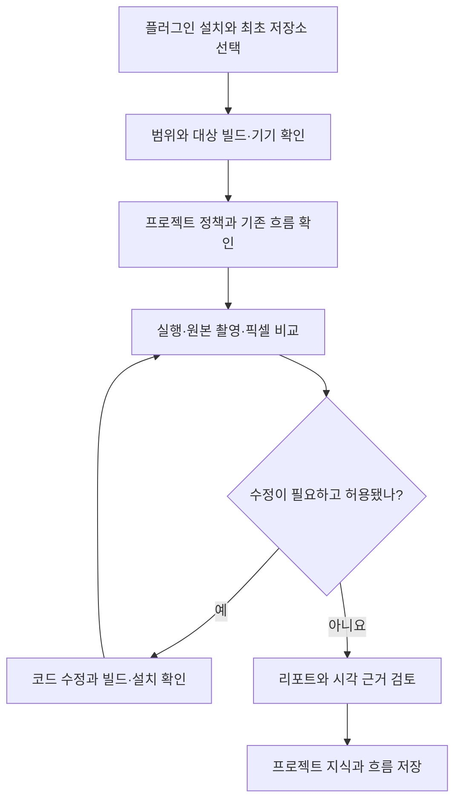

# Mobile QA

Author: JunyoungJung · 2026-10-23 · Version: 0.2.0

[English](README.en.md) · [결과 리포트 예시](examples/design-review/report.md)

Codex·Claude Code에서 **모바일 앱 품질 검증(QA) → 디자인 비교 → 승인된 코드 수정 → 재검증 → 보고서와 프로젝트 지식 저장**을 이어서 수행하는 macOS용 로컬 플러그인입니다. `mobile-device-qa`·`test-accounts`·최초 저장소 설정 스킬을 함께 제공합니다. 관찰·판정·근거는 Markdown 리포트로 정리합니다. [1], [2], [3]

## 무엇을 할 수 있나요?

표 1에서 필요한 작업과 결과물을 먼저 확인합니다. 겹침(overlay)은 기준과 후보를 한 화면에 포개고, 차이 이미지(diff)는 픽셀 차이를 드러냅니다. [1], [2]

*표 1. 작업별 준비물과 결과물*

| 하고 싶은 작업 | 준비할 것 | 받는 결과 |
|---|---|---|
| iPhone·iPad·Android 기능 QA | 프로젝트·설치 빌드·기기·시나리오·기대 동작 | 항목별 관찰과 판정, 스크린샷·대표 조작 GIF를 포함한 Markdown 리포트 |
| 기존 앱 또는 Figma와 디자인 비교 | 기준 앱/빌드 또는 정확한 Figma 프레임·버전, 새 구현, 같은 화면 조건 | 원본 PNG, 25%·50%·75% 겹침, 차이 이미지·마스크, 픽셀 수치와 불일치 위치 |
| 차이를 수정하고 재검수 | 수정 가능한 코드 범위, 빌드·설치 절차와 권한 | 최초 수정 전 / 최종 변경 빌드의 수정 후 비교, 코드 위치, 새 캡처, 남은 차이 |
| 프로젝트 정책·지식·흐름 관리 | 프로젝트 경로, 적용할 정책과 확인한 근거 | 프로젝트별 정책 출처, 확인한 지식, 재사용 흐름과 다시 검증할 조건 |
| 시험 계정 조회·등록·로그인 | 프로젝트·환경·용도, 로그인 시 신뢰 등록한 프로필과 기기 | 선택한 계정 별칭 또는 로그인 결과, 환경 확인·입력 정리 상태 |
| 이미 가진 PNG 두 장 비교 | 같은 픽셀 크기와 색 조건의 PNG | 앱·기기·Figma 연결 없이 겹침·차이·픽셀 수치 생성 |

준비된 `agent-device` 세션과 기존 흐름을 재사용합니다. 실행기(runner)는 기기 UI를 조작하는 프로세스입니다. Figma 자료는 이미 연결된 도구로 내보내거나 PNG로 제공하며, 일반 기능 QA에는 Figma가 필요하지 않습니다. 원본 계정값은 채팅이나 리포트에 넣지 않습니다.

이미지 비교 명령과 출력 파일·수치 해석 방법은 [예시 리포트](examples/design-review/report.md)에서 합성 PNG 입력으로 확인할 수 있습니다.

## 어떻게 사용하나요?

그림 1는 설치부터 결과 검토와 프로젝트 지식 저장까지의 흐름입니다. 코드 수정과 빌드·설치는 요청한 범위에서 수행합니다. [1], [2]



*그림 1. 최초 설정부터 QA와 프로젝트 지식 저장까지의 흐름*

GitHub은 Mermaid를 직접 표시합니다. VSCode 기본 Markdown Preview에서 그림으로 보려면 Mermaid 확장이 필요하며, 확장 없이도 코드로 흐름을 읽을 수 있습니다.

1. 사용할 호스트에 플러그인을 설치합니다.
2. `setup`으로 내장 또는 외장 저장소의 원하는 기존 폴더를 선택합니다. 다음 실행부터는 저장된 볼륨을 확인해 재사용합니다.
3. 프로젝트·대상 빌드·기기·기대 결과를 알려주고 QA를 요청합니다. 코드 수정·빌드·설치까지 원하면 그 범위도 함께 지정합니다.
4. 기능을 관찰하거나 같은 화면 조건의 이미지를 비교합니다. 수정한 경우 새 빌드가 설치됐는지 확인하고 다시 촬영합니다.
5. 리포트와 첨부물을 받고, 확인한 지식과 재사용 흐름을 해당 프로젝트의 전용 저장소에 남깁니다.

준비가 부족하면 해당 항목을 `준비 필요` 또는 `미검증`으로 남깁니다. 기기 점유·보호된 캡처·빌드 불명·입력 정리 미확인을 성공으로 처리하지 않습니다.

## 작업별 준비물

표 2에서 작업 범위에 필요한 준비를 확인합니다. 정상 로그인 세션을 재사용하는 QA에는 계정 입력 도구를 준비할 필요가 없습니다. [1], [2], [3]

*표 2. 작업 범위별 실행 환경*

| 작업 범위 | 필요한 준비 |
|---|---|
| 모든 QA 실행 | macOS, Python 3.11–3.13, 선택·검증한 저장 폴더 |
| PNG 비교 | 실행하는 Python 환경의 [Pillow·NumPy](requirements.txt), 같은 픽셀 크기·호환 색 조건의 단일 프레임 표준 동적 범위(SDR) PNG. 지원 비트 깊이는 [디자인 검수 절차](skills/mobile-device-qa/references/design-review.md) 참조 |
| 실기기 기능 QA | Node.js 22.12 이상과 `agent-device`, 연결·승인된 기기와 확인한 설치 앱/빌드 |
| iOS 실기기 | Xcode·명령행 도구, 페어링·개발자 모드, 필요한 runner와 유효한 사용자 서명 |
| Android 실기기 | 승인된 ADB 연결; 계정 입력 JAR 빌드에는 Android SDK·JDK 추가 필요 |
| 계정 등록·변경 | macOS 13 이상, 사용자 서명을 준비한 native helper와 비밀값 전용 로컬 입력 창 |
| 전용 계정 로그인 | 저장된 시험 계정, 검토·신뢰 등록한 프로필, 해당 플랫폼 입력 도구, 현재 환경을 확인할 수 있는 로그인 화면 |
| 코드 수정·재검수 | 수정할 checkout과 범위, 프로젝트 빌드·설치 절차, 반영된 빌드를 확인할 방법 |

iOS 전용 계정 입력은 **agent-device 0.21.30**의 검증한 소스만 지원합니다. 해시(hash)는 해당 소스와 입력 파일의 내용을 식별하는 값입니다. 임의 업데이트·소스 패치·Apple 서명 자동 준비는 수행하지 않습니다. 미서명 컴파일은 기기 실행 준비 완료를 뜻하지 않습니다.

### 사용자 도구 경로

기본 탐지와 다른 설치 위치를 사용할 때는 해당 실행 환경에서 다음 값을 지정합니다. 플러그인은 전역 셸 설정이나 프로젝트 설정을 자동 변경하지 않습니다.

- Android SDK: `ANDROID_HOME` 또는 `ANDROID_SDK_ROOT`. 둘 다 설정하면 같은 SDK를 가리켜야 합니다.
- JDK: `JAVA_HOME`. 미지정 시 등록 JDK와 `PATH`의 같은 JDK에 속한 `java`·`javac`를 확인하고, 마지막으로 표준 Android Studio 번들 위치를 확인합니다.
- Xcode: `DEVELOPER_DIR`. iOS 빌드에 사용한 실제 Developer 경로를 기록하고 전용 로그인 실행에도 같은 경로를 사용합니다.
- iOS runner 소스: `MOBILE_QA_AGENT_DEVICE_PACKAGE`. CLI wrapper 때문에 패키지 위치를 찾지 못할 때 설치된 패키지 루트를 명시할 수 있습니다. 버전·공식 소스 해시 검사는 그대로 적용하며 잘못 지정한 경로를 다른 설치본으로 대체하지 않습니다.

`doctor`의 `agent_device_source`는 전용 runner에 사용할 소스 검증 결과입니다. 이 값만으로 wrapper CLI나 기기 실행까지 검증했다고 판단하지 않습니다.

## 설치

[GitHub 저장소](https://github.com/Jimmy-Jung/mobile-qa)를 marketplace로 등록하고 사용할 호스트에 설치합니다.

Codex:

```bash
codex plugin marketplace add https://github.com/Jimmy-Jung/mobile-qa.git
codex plugin add mobile-qa@mobile-qa-marketplace
```

Claude Code:

```bash
claude plugin marketplace add Jimmy-Jung/mobile-qa
claude plugin install mobile-qa@mobile-qa-marketplace --scope user
```

Python 환경에 [requirements.txt](requirements.txt)의 패키지를 준비하고 기기 QA에는 `agent-device`를 별도로 설치합니다. 환경·패키지 캐시·빌드 캐시는 사용하는 프로젝트의 저장 정책을 따릅니다. 이 플러그인은 MCP 서버·상시 서비스·외부 모델 서비스·telemetry·SDK·컴파일 바이너리를 추가하지 않습니다.

로컬 checkout이나 ZIP으로 설치할 때는 marketplace source를 실제 플러그인 루트 경로로 바꿉니다. [v0.2.0 릴리스](https://github.com/Jimmy-Jung/mobile-qa/releases/tag/v0.2.0)에서 ZIP과 SHA-256 파일을 받을 수 있습니다. GitHub 배포와 호스트 공식 디렉터리 등재는 별개이며, 형식 근거는 참고문헌 [7]–[10]에 있습니다.

## 최초 저장소 선택

Claude Code에서는 `/mobile-qa:setup`, Codex에서는 설치된 `setup` 스킬을 선택합니다. 설정 없이 첫 QA·빌드를 요청해도 setup으로 연결합니다. 플러그인 루트에서 직접 실행할 수도 있습니다. [4]

```bash
python3 -B scripts/setup.py
python3 -B scripts/doctor.py
```

저장된 설정이 없을 때만 macOS 폴더 선택 창이 열립니다. **내장 또는 외장 저장소의 원하는 기존 폴더**를 선택하면 실제 볼륨·마운트·볼륨 UUID·쓰기 가능 여부와 심볼릭 링크 없는 경로를 확인해 저장합니다. 다음부터는 동일한 볼륨을 검증하고 재사용합니다.

내장·외장 여부는 플러그인의 선택 제한이 아닙니다. 폴더 선택과 실행에는 프로젝트·호스트의 추가 저장 정책도 함께 적용합니다.

저장소 연결이 해제됐거나 UUID가 다르면 중단하고 재연결·재선택을 안내합니다. 선택한 폴더 밖의 다른 경로로 자동 대체하지 않습니다. 위치 변경은 다음처럼 명시합니다.

```bash
python3 -B scripts/setup.py --storage-dir /path/to/storage-folder
```

`doctor`는 읽기 전용 준비 확인입니다. `ready`는 해당 점검 범위의 준비 상태이며 기기 연결·설치 빌드·로그인·QA 통과를 대신하지 않습니다. 도구 설치·업데이트·서명·계정 원문 조회를 수행하지 않습니다. 분리 검증에만 `MOBILE_QA_CONFIG`로 별도 비밀값 없는 설정 파일을 지정하며 기본 사용에는 필요하지 않습니다.

setup과 native 빌드 도구는 선택한 볼륨을 재검증합니다. **단독 PNG 비교 CLI는 이미지와 경로만 처리하며 저장소 설정을 자동 조회하지 않습니다.** 직접 실행할 때는 [예시의 출력 위치 검사](examples/design-review/report.md#직접-비교-실행)를 먼저 수행하고 저장소 연결을 유지합니다. QA 에이전트에도 검증한 저장 폴더 안의 출력 위치를 사용하도록 요청합니다.

## 이렇게 요청하세요

Codex에서는 설치된 `mobile-device-qa` 또는 `test-accounts` 스킬을 선택합니다. Claude Code에서는 `/mobile-qa:mobile-device-qa`, `/mobile-qa:test-accounts`로 시작할 수 있습니다. 아래 예시에서 현재 프로젝트와 확인할 대상·빌드·환경을 구체적으로 지정하세요. 비밀번호는 프롬프트에 넣지 않습니다.

### 기능 QA

> mobile-device-qa로 현재 checkout과 연결된 Android 시험 기기를 검증해줘. 기존 로그인 세션을 유지하면서 목록 열기 → 상세 진입 → 목록 복귀 때 선택한 필터가 유지되는지 확인해줘. 항목별 결과, 스크린샷과 대표 조작 GIF, 미검증 항목을 Markdown 리포트로 작성해줘.

### Figma 디자인 검수와 수정

> 첨부한 Figma 프레임과 버전을 기준으로 지정한 iPhone의 새 앱 빌드를 검수해줘. 같은 화면 크기·배율·테마·폰트·데이터·상태에서 촬영하고 겹침과 차이 이미지로 불일치를 찾아줘. 관련 UI 코드 수정과 프로젝트 절차에 따른 빌드·설치까지 수행한 뒤 같은 조건으로 재촬영해줘. 기준은 유지하고 최초 수정 전과 최종 변경 빌드의 결과를 비교해줘.

### 기존 앱과 비교만 하기

> 같은 기기의 같은 상태에서 기준 앱과 새 빌드의 목록 화면을 각각 촬영해줘. 위치·간격·폰트·색·에셋을 원본 크기로 비교하고 겹침·픽셀 수치·불일치 리포트를 작성해줘. 이번에는 코드 수정·재설치·계정 전환 없이 검수 결과만 필요해.

### 프로젝트 정책·지식·재사용 흐름 관리

> QA 전에 이 프로젝트의 전용 저장소에서 정책과 기존 탐색 흐름을 확인해줘. 데이터 보존 정책을 적용하고 기존 흐름을 재사용해줘. 끝나면 새로 확인한 지식과 재사용 가능한 흐름의 근거·빌드 범위·재검증 조건을 이 프로젝트의 QA 사용자 데이터 폴더에 저장하고, 원본 캡처는 선택한 저장소에 유지해줘.

### 계정 조회와 로그인

> test-accounts로 이 프로젝트의 staging 환경 tester 용도 계정을 찾아줘. 선택한 별칭과 준비 상태만 알려줘. 정상 로그인 세션은 유지하고, 로그인이 필요하면 미리 신뢰 등록한 sample-staging 프로필과 지정한 기기를 사용해줘. 로그인 결과·환경 확인·입력 정리 상태를 구분해서 보고해줘.

로그인 프로필은 앱·환경·입력 필드·성공 확인 방법을 정의하는 비밀값 없는 JSON 계약입니다. 계정이나 앱이 처음이면 계정 등록 또는 프로필 검토·등록을 먼저 요청합니다. 실제 아이디·비밀번호는 전용 로컬 입력 창으로 등록합니다. [가상 프로필](skills/test-accounts/examples/login-profile.example.json)을 그대로 신뢰하지 말고 실제 앱 ID·환경·용도·화면 selector와 대조한 후 `register-profile --project PROJECT --file JSON`으로 명시 등록합니다. `login`에는 `--login-profile NAME`이 필요합니다. release·도구·프로필 내용이 바뀌면 다시 검토·등록합니다. 자세한 준비와 호출은 [test-accounts](skills/test-accounts/SKILL.md)에 있습니다. [3]

## 결과물은 어떻게 읽나요?

기본 결과물은 **Markdown 리포트와 그 리포트가 참조하는 이미지·GIF 파일**입니다. 공유하거나 다른 폴더로 옮길 때는 리포트와 필요한 첨부물을 함께 유지합니다. 별도 HTML 앱은 필요하지 않습니다.

```text
실행 결과 폴더/
  report.md                  항목별 판정·관찰·근거·남은 작업
  assets/                    선별한 스크린샷·대표 실제 조작 GIF
  design/                    디자인 검수 시의 비교 결과
    before/                  최초 후보와 기준의 비교
    final/                   최종 변경 빌드와 같은 기준의 비교
      overlay-25.png
      overlay-50.png
      overlay-75.png
      diff.png
      mismatch-mask.png
      comparison.json
```

위 트리는 이해를 위한 구성 예시입니다. 실제 폴더명은 프로젝트 형식에 맞추며 리포트의 링크를 따라 확인합니다. PNG 비교 명령은 이미지와 JSON을 만들고, QA 에이전트가 근거를 검토해 Markdown 리포트와 실제 조작 GIF를 별도로 작성·첨부합니다.

표 3은 판정과 첨부물의 해석 범위를 설명합니다. 계정 선택·인증·환경 확인·입력 정리는 각각의 결과로 읽습니다. [1], [2], [3]

*표 3. 결과 판정과 시각 근거를 읽는 방법*

| 결과 | 읽는 방법 |
|---|---|
| `통과` | 명시한 기기·빌드·범위에서 기대 동작을 근거로 확인 |
| `실패` | 기대와 다른 관찰과 그 근거·영향을 확인 |
| `미검증` | 실행·관찰 근거가 충분하지 않음. 이유와 다음 확인을 읽음 |
| `준비 필요` | 도구·빌드·권한·화면 조건 등을 먼저 준비해야 함 |
| 원본 PNG·최초 수정 전 / 최종 수정 후 | 실제 비교 대상·촬영 조건·빌드가 맞는지 확인 |
| 25%·50%·75% 겹침 | 두 화면의 윤곽·정렬·간격이 같은지 확인 |
| `diff.png`·`mismatch-mask.png` | 변경 영역의 위치를 찾음. 밝기나 면적만으로 원인을 단정하지 않음 |
| `comparison.json` | 입력 해시·색 처리·제외 범위·변경 픽셀·차이 영역(bbox)와 일치 여부를 확인 |
| 대표 조작 GIF | 실제 조작과 시간 순서를 확인. 정지 이미지를 반복한 자료로 대체하지 않음 |
| 프로젝트 지식 갱신 요약 | 저장한 항목·근거·적용 범위·다시 검증할 조건을 확인 |

`raw_exact`는 색 변환·마스크 적용 전 전체 RGBA 픽셀의 일치 여부입니다. RGBA는 빨강·초록·파랑·투명도 채널을 뜻하며, `compared_exact`는 선언한 색 처리 후 제외하지 않은 픽셀에서의 일치 여부입니다. `cleanup`이 미확인·실패이면 입력값이 남아 있을 수 있으므로 일반 캡처·녹화·화면 트리 수집과 로그인 재제출을 중단합니다. [2], [3]

크기·상태가 다른 이미지를 자동 확대·정렬·크롭해 일치시키지 않습니다. 다시 촬영·내보내기해 조건을 맞춥니다. 비교 명령의 종료 코드 0은 실행 완료이며 픽셀 일치나 디자인 전체 통과를 뜻하지 않습니다. 마스크가 있으면 제외 영역 밖 결과만, 색 변환이 있으면 해당 변환 후 결과만 주장합니다. 기능·접근성·재생·성능과 다른 기기의 통과는 별도 근거가 필요합니다.

## 프로젝트별 저장 위치

표 4처럼 설정·프로젝트 지식은 플러그인 설치 폴더와 분리된 사용자 데이터 폴더에, 대용량 근거와 빌드 결과는 선택한 저장소에 보관합니다. 표의 기본 경로는 지원 운영체제인 macOS 기준입니다. [3], [4], [5]

*표 4. 로컬 상태와 선택한 저장소의 저장 책임*

| 데이터 | 위치와 역할 |
|---|---|
| 저장소 선택·볼륨 식별 | `~/Library/Application Support/mobile-qa/config.json` |
| 시험 계정 카탈로그·비밀 저장소 | `~/.config/agent-test-accounts/` |
| 프로젝트 정책·지식·재사용 흐름·신뢰한 프로필 | `~/Library/Application Support/mobile-device-qa/projects/<project-key>/` |
| 빌드·캐시·원본 로그·캡처·겹침·차이·영상·리포트 | 선택한 폴더 아래 프로젝트 물리 경로별 작업 폴더 |

지식의 진입점은 프로젝트 전용 폴더의 `project-qa.md`입니다. 필요할 때 `policies.md`·`knowledge.md`로 나누고 새 QA 흐름은 `flows/`와 `flows/index.md`에서 관리합니다. 기존 프로젝트 테스트는 원래 위치에서 재사용하며 근거와 계약을 연결합니다. 폴더 위치는 저장소 식별 도구로 구하므로 이름을 추측해 다른 프로젝트와 합치지 않습니다.

Codex·Claude가 같은 로컬 저장소를 사용합니다. 정책·지식은 스킬 내부에 쌓지 않으며, 설치·업데이트로 기존 계정과 지식을 이동·삭제하거나 공개 패키지에 포함하지 않습니다. 기본 비밀 파일은 로컬 권한으로 보호하는 **평문 저장**입니다. 같은 사용자 권한의 프로세스·백업이 접근할 수 있는 보안 범위는 [SECURITY.md](SECURITY.md)를 확인합니다.

Claude 실행 역할은 `mobile-qa:mobile-qa-runner`로 제공됩니다. [Codex 역할](integrations/codex/mobile-qa-runner.toml)은 지원하는 프로젝트에 사용자가 선택 설치하며 전역 설정을 자동 수정하지 않습니다. 기본 모델은 현재 세션을 상속하고, 위임이 불가능하면 메인이 동일 계약을 수행합니다. 최종 판정·코드 수정·지식 승격은 메인이 맡습니다. [6], [10]

표 5에서 상세 절차를 찾을 수 있습니다.

*표 5. 상세 문서 안내*

| 문서 | 확인할 내용 |
|---|---|
| [최초 설정](skills/setup/SKILL.md) | 저장소 선택·재사용·명시적 위치 변경 |
| [기기 QA](skills/mobile-device-qa/SKILL.md) | 범위·세션·기기 점유·복구·보고 |
| [디자인 검수](skills/mobile-device-qa/references/design-review.md) | 촬영 조건·픽셀 비교·수정·재촬영 |
| [프로젝트 지식](skills/mobile-device-qa/references/project-knowledge.md) | 정책·흐름·지식·재검증 조건 |
| [시험 계정](skills/test-accounts/SKILL.md) | 비밀값 저장·프로필 신뢰·로그인·입력 정리 |
| [리포트 예시](examples/design-review/report.md) | 합성 입력·실측 결과·직접 비교 명령 |
| [보안 범위](SECURITY.md) | 비밀값 노출 범위와 취약점 제보 |

## 검증·배포

테스트는 루트 `tests`, 각 스킬의 `tests`를 각각 `python3 -B -m unittest discover -s 경로`로 실행합니다. 로컬 임시 폴더·로그는 선택한 저장 폴더 안에서 프로젝트·호스트의 추가 저장 정책을 지키는 경로에 둡니다. CI는 합성 입력과 가상 볼륨 정보만 쓰며 실제 기기·계정·Library 자료를 사용하지 않습니다.

```bash
python3 -B scripts/package.py --check
claude plugin validate . --strict
claude plugin validate .claude-plugin/plugin.json --strict
```

메인테이너가 최종 공개 소스를 검토한 뒤 `python3 -B scripts/package.py --write-inventory`로 `release.json`을 명시 동결합니다. 소비자가 실행 오류를 우회하려고 재생성하지 않습니다. `python3 -B scripts/package.py --output-dir /selected/storage/folder`는 release·공개 파일 검사를 통과한 파일만 압축합니다. 문서·예시가 포함된 release 내용이 바뀌어도 해당 helper·runner와 프로필 신뢰를 다시 준비해야 합니다.

자체 코드는 MIT이며 upstream 고지는 [THIRD_PARTY_NOTICES.md](THIRD_PARTY_NOTICES.md)에 보존합니다. 문서의 합성 예시·정적 검사·컴파일 성공은 실제 호스트 설치·실기기 로그인·앱 QA·공개 게시의 성공을 뜻하지 않습니다.

## 참고문헌

호스트 형식 문서는 2026-10-22에 확인했습니다. 실제 지원 여부는 설치한 호스트 버전에 따라 확인하며, 아래 로컬 소스는 플러그인의 계약과 구현 근거입니다.

[1] Mobile QA, [기기 QA 스킬](skills/mobile-device-qa/SKILL.md). 범위·근거·복구·리포트와 최종 판정 계약.

[2] Mobile QA, [디자인 검수 절차](skills/mobile-device-qa/references/design-review.md) 및 [이미지 비교 구현](skills/mobile-device-qa/scripts/compare_screenshots.py). PNG 입력·색 처리·제외 영역·수치·재촬영 근거.

[3] Mobile QA, [시험 계정 스킬](skills/test-accounts/SKILL.md) 및 [iOS 입력 빌더](skills/test-accounts/scripts/build_ios_input.py). 평문 저장·프로필 신뢰·입력 정리·버전 고정·서명 조건.

[4] Mobile QA, [설정 스킬](skills/setup/SKILL.md), [저장 위치 검사](mobile_qa/storage.py), [준비 상태 진단](scripts/doctor.py). 최초 폴더 선택·볼륨 재검증·읽기 전용 점검 근거.

[5] Mobile QA, [프로젝트 지식 관리](skills/mobile-device-qa/references/project-knowledge.md). 정책·흐름·지식과 재검증 조건의 저장 절차.

[6] Mobile QA, [모델·반환 정책](skills/mobile-device-qa/references/model-policy.md) 및 [Codex 실행 역할](integrations/codex/mobile-qa-runner.toml). 현재 모델 상속과 메인·실행기의 책임.

[7] Agent Plugins, [Agent Plugins 1.0 manifest schema](https://agent-plugins.org/schemas/1.0.0/plugin.schema.json). 공용 플러그인 식별과 확장 필드의 공식 스키마.

[8] OpenAI, [Package your plugin](https://developers.openai.com/plugins/build/plugins). 루트 manifest·패키징 구조·최초 설정 스킬의 공식 안내.

[9] Anthropic, [Plugin manifest reference](https://code.claude.com/docs/en/plugins-reference). Claude 호환 manifest와 구성요소 경로의 공식 문서.

[10] Anthropic, [Create custom subagents](https://code.claude.com/docs/en/sub-agents). 플러그인 실행 역할·모델 상속·스킬 사전 로딩의 공식 안내.
