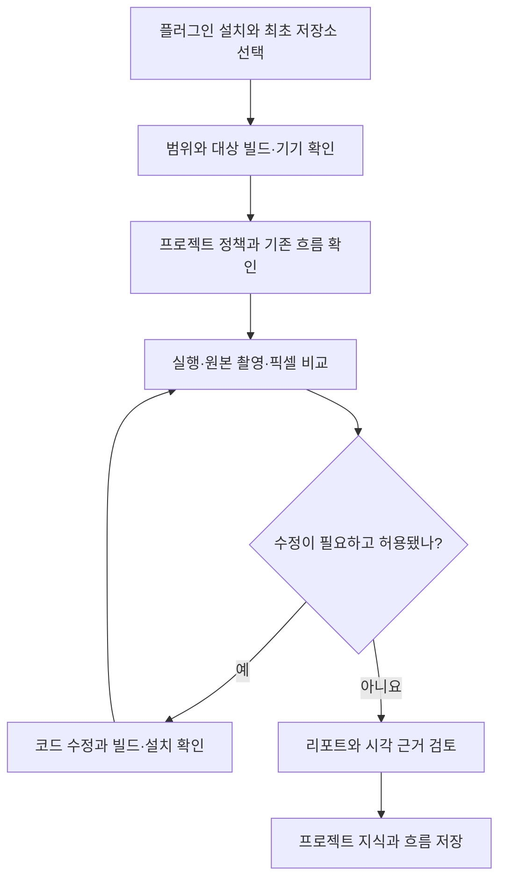

# Mobile QA 운영 레퍼런스

Author: JunyoungJung · 2026-10-28 · Version: 0.3.1

이 문서는 에이전트와 운영자가 참조하는 상세 절차입니다. 플러그인이 무엇이고 왜 쓰는지는 [README](../README.md)에 있습니다. 경로와 명령은 지원 운영체제인 macOS 기준입니다.

## 도구 선택

[역할별 기본 경로](../skills/mobile-device-qa/SKILL.md#역할별-도구-선택)와 [상세 선택 기준](../skills/mobile-device-qa/references/tool-selection.md)을 적용합니다. iOS는 `simctl` + 설치된 `xcui`/AXe·CUA, Android Emulator는 Android CLI + ADB를 기본으로 사용합니다. 기존 스택별 테스트를 우선하고 필요한 공통 회귀만 Maestro로 작성하며 Flutter의 OS·네이티브 경계에는 Patrol을 선택합니다. 원본 PNG 비교와 Markdown·GIF 보고는 조작 도구와 독립적입니다.

## 전체 흐름

그림 1은 설치부터 결과 검토와 프로젝트 지식 저장까지의 흐름입니다. 코드 수정과 빌드·설치는 요청한 범위에서 수행합니다. [1], [2]



*그림 1. 최초 설정부터 QA와 프로젝트 지식 저장까지의 흐름*

GitHub은 Mermaid를 직접 표시합니다. VSCode 기본 Markdown Preview에서 그림으로 보려면 Mermaid 확장이 필요하며, 확장 없이도 코드로 흐름을 읽을 수 있습니다.

1. 사용할 호스트에 플러그인을 설치합니다.
2. `setup`으로 내장 또는 외장 저장소의 원하는 기존 폴더를 선택합니다. 다음 실행부터는 저장된 볼륨을 확인해 재사용합니다.
3. 프로젝트·대상 빌드·기기·기대 결과를 알려주고 QA를 요청합니다. 코드 수정·빌드·설치까지 원하면 그 범위도 함께 지정합니다.
4. 기능을 관찰하거나 같은 화면 조건의 이미지를 비교합니다. 수정한 경우 새 빌드가 설치됐는지 확인하고 다시 촬영합니다.
5. 리포트와 첨부물을 받고, 확인한 지식과 재사용 흐름을 해당 프로젝트의 전용 저장소에 남깁니다.

준비가 부족하면 해당 항목을 `준비 필요` 또는 `미검증`으로 남깁니다. 기기 점유·보호된 캡처·빌드 불명·입력 정리 미확인을 성공으로 처리하지 않습니다.

## 작업별 준비물과 결과물

표 1에서 필요한 작업과 결과물을 먼저 확인합니다. 겹침(overlay)은 기준과 후보를 한 화면에 포개고, 차이 이미지(diff)는 픽셀 차이를 드러냅니다. [1], [2]

*표 1. 작업별 준비물과 결과물*

| 하고 싶은 작업 | 준비할 것 | 받는 결과 |
|---|---|---|
| iPhone·iPad·Android 기능 QA | 프로젝트·설치 빌드·기기·시나리오·기대 동작 | 항목별 관찰과 판정, 스크린샷·대표 조작 GIF를 포함한 Markdown 리포트 |
| iOS Simulator QA·디자인 검수 | Simulator용 앱·정확한 UDID·runtime·화면 조건, 사용 가능한 조작 경로와 `simctl` | 원본 캡처·동작 근거·픽셀 비교와 Markdown 리포트. 확인 범위는 Simulator로 표시 |
| Android Emulator QA·디자인 검수 | Emulator용 앱·정확한 serial·Android 버전·화면 조건, Android CLI·ADB와 기존 UI 테스트 | 원본 PNG·동작 근거·픽셀 비교와 Markdown 리포트. CLI 미준비 시 ADB·기존 도구로 가능한 검증을 계속 |
| 기존 앱 또는 Figma와 디자인 비교 | 기준 앱/빌드 또는 정확한 Figma 프레임·버전, 새 구현, 같은 화면 조건 | 원본 PNG, 25%·50%·75% 겹침, 차이 이미지·마스크, 픽셀 수치와 불일치 위치 |
| 차이를 수정하고 재검수 | 수정 가능한 코드 범위, 빌드·설치 절차와 권한 | 최초 수정 전 / 최종 변경 빌드의 수정 후 비교, 코드 위치, 새 캡처, 남은 차이 |
| 프로젝트 정책·지식·흐름 관리 | 프로젝트 경로, 적용할 정책과 확인한 근거 | 프로젝트별 정책 출처, 확인한 지식, 재사용 흐름과 다시 검증할 조건 |
| 시험 계정 조회·등록·로그인 | 프로젝트·환경·용도·대상, 전용 입력기를 사용할 때는 신뢰 등록한 프로필 | 선택한 계정 별칭 또는 로그인 결과, 환경 확인·입력 정리 상태 |
| 이미 가진 PNG 두 장 비교 | 같은 픽셀 크기와 색 조건의 PNG | 앱·기기·Figma 연결 없이 겹침·차이·픽셀 수치 생성 |

실기기는 준비된 `agent-device` 세션과 기존 흐름을 재사용합니다. iOS Simulator는 [Simulator QA](../skills/mobile-device-qa/references/simulator.md)에 따라 기존 UI 테스트·호스트 화면 제어·이미 설치된 Simulator 도구와 `simctl` 캡처를 사용할 수 있습니다. 실행기(runner)는 UI를 조작하는 프로세스이며 모든 경로에 같은 runner를 요구하지 않습니다. Figma 자료는 이미 연결된 도구로 내보내거나 PNG로 제공하며, 일반 기능 QA에는 Figma가 필요하지 않습니다. 계정 입력은 기본적으로 전용 로컬 창을 사용합니다. 사용자가 현재 채팅에 제공한 새 계정도 전용 등록 경로로 저장·재사용하며 응답이나 리포트에 원문을 반복하지 않습니다.

이미지 비교 명령과 출력 파일·수치 해석 방법은 [예시 리포트](../examples/design-review/report.md)에서 합성 PNG 입력으로 확인할 수 있습니다.

## agent-device의 기능과 플러그인의 역할

`agent-device`는 기기 UI를 조작하고 상태와 실행 근거를 수집하는 별도 CLI입니다. Mobile QA는 그 명령을 어떻게 검증에 사용할지 정하는 스킬과 로컬 보조 도구를 제공합니다. 원도구의 명령 성공을 기능 통과로 바로 바꾸지 않고, 프로젝트의 기대값과 실제 관찰을 대조합니다. [1]

아래 기능은 **2026-10-23에 확인한 CLI 0.21.30 도움말과 공식 문서** 기준입니다. 실제 사용 가능 여부는 플랫폼·실기기/가상 기기·백엔드·서명·도구 준비 상태에 따라 달라집니다. 이 표는 명령과 워크플로우의 연결이며, 모든 명령을 모든 기기에서 시험했다는 뜻은 아닙니다. [11]

| 원도구 기능 | 주요 명령 | 플러그인에서 사용하는 방식 |
|---|---|---|
| 대상·앱·세션 관리 | `devices`, `apps`, `open`, `close`, `session`, `capabilities` | 앱·기기·세션을 명시하고 기존 연결을 재사용합니다. 설치 빌드의 정체성은 프로젝트의 빌드·설치 근거도 함께 확인합니다. |
| 접근성 트리·요소 속성 조회 | `snapshot`, `find`, `get` | 현재 화면의 요소 참조(ref)·식별자·문구·값을 읽어 조작 대상을 찾습니다. 화면 변경 후 오래된 ref를 재사용하지 않습니다. |
| 사용자 입력과 제스처 | `press`, `click`, `fill`, `type`, `longpress`, `scroll`, `gesture` | 탭·입력·이동·드래그·확대·축소를 수행합니다. 접근성 정보가 부족하면 스크린샷을 직접 확인한 뒤 좌표를 사용합니다. |
| 조건 대기와 상태 확인 | `wait`, `is`, 동작별 `--settle` | 로딩 종료나 기대 문구·요소 상태를 기다리고 확인합니다. 탭 수락 응답만으로 다음 화면 도착을 통과시키지 않습니다. |
| 앱 전환과 시스템 조건 | `home`, `back`, `app-switcher`, `orientation`, `alert`, `settings`, `push` | 지원되는 대상에서 복귀·회전·권한·알림 진입을 시험합니다. 변경한 설정은 기록하고 복원합니다. |
| 화면 증거와 차이 조회 | `screenshot`, `record`, `diff` | 원본 캡처와 조작 영상을 남깁니다. 이 플러그인의 정량 디자인 비교는 별도 `compare_screenshots.py`가 수행합니다. |
| 연속 실행과 재생 | `batch`, `replay`, `test` | 짧은 연속 조작은 batch, 단일 기록은 `.ad`, 지원되는 하위 흐름은 YAML `runFlow`, 여러 기록은 테스트 묶음으로 실행할 수 있습니다. [14] |
| 로그와 진단 정보 | `logs`, `events`, `network`, `trace`, `debug` | 실패 단계와 실행 근거를 연결합니다. `network`는 앱 로그의 HTTP(S) 항목을 읽고, Apple 크래시 심볼화에는 대응하는 심볼 자료가 필요합니다. [12] |
| 성능과 메모리 자료 | `perf`, `react-devtools`, `cdp` | 요청한 진단에 한해 지원되는 계측을 사용합니다. React Native 개발 빌드의 컴포넌트·JS heap 분석을 임의의 네이티브 앱 내부 조회로 확장하지 않습니다. [12] |

iOS 시스템 UI는 `open com.apple.springboard`로 세션 대상을 바꿔 조회·조작할 수 있습니다. 설치 CLI의 `help ios-system-ui`는 실기기 iPhone의 SpringBoard 열기·snapshot·보이는 아이콘 누르기까지 업스트림 검증으로 구분하며, 위젯 추가·편집·제거는 시뮬레이터에서만 검증되어 실기기에서는 별도 확인이 필요합니다. [11]

원도구에는 오디오 레벨 측정, TV 리모컨, 웹·데스크톱, 원격 기기 같은 기능도 있습니다. 이 플러그인의 **기기 QA 대상은 iPhone·iPad·Android 실기기·iOS Simulator·Android Emulator**이며, 원도구의 다른 대상을 자동으로 지원 범위에 포함하지 않습니다. Simulator는 `agent-device` 없이도 QA·디자인 검수·보고를 수행하며 실기기 결과와 구분합니다. PNG만 비교하는 작업은 기기 제어 없이 실행합니다.

다음 작업은 별도 구성요소가 담당합니다.

- **Figma 기준 이미지 확보:** 이미 연결된 Figma 도구 또는 제공된 프레임 PNG를 사용합니다. `agent-device`가 Figma 파일을 읽는 것은 아닙니다.
- **픽셀 비교와 보고:** 플러그인의 Python 비교 도구가 같은 크기의 PNG에서 겹침·차이·수치를 생성하고, 호스트 에이전트가 근거를 검토해 Markdown 리포트와 GIF를 구성합니다. [2]
- **계정 조회와 비밀 입력:** `test-accounts`와 준비된 전용 입력 도구를 사용합니다. 일반 `fill`, replay 변수, 명령 인자에 비밀번호를 넣지 않습니다. [3]
- **소스 수정과 앱 빌드:** 호스트 에이전트가 허용된 코드 범위와 프로젝트의 빌드 절차를 따릅니다. `install`·`reinstall`은 준비된 바이너리의 설치 기능이며 소스 빌드를 대신하지 않습니다.

## 제공 기능을 조합한 여섯 가지 워크플로우

1. **화면 탐색 → 기능 QA:** 대상 앱·빌드·기기와 기대값을 고정하고, `snapshot`으로 읽은 현재 요소를 조작한 뒤 `wait`·`is`·`get`으로 결과를 확인합니다. 예를 들어 목록 필터 선택 → 상세 진입 → 목록 복귀 후 필터 유지 여부를 확인하고 항목별 스크린샷과 대표 조작 GIF를 남깁니다. [1]
2. **조건 고정 → 간헐적 버그 재현:** 계정·콘텐츠·설정·시작 상태를 맞추고 같은 동작을 반복하며 필요한 구간의 녹화와 로그를 수집합니다. 재현되지 않은 증상은 수정됐다고 처리하지 않고, 실행 횟수·실패 단계·미검증 조건을 남깁니다. [README의 사례 1](../README.md#사례-1-1년-가까이-재현되지-않던-검은-화면)이 그 적용 예입니다.
3. **기준 촬영 → 디자인 비교 → 수정 후 재촬영:** 기존 앱 또는 Figma 프레임과 새 구현의 크기·배율·테마·데이터·화면 상태를 맞춥니다. `screenshot` 원본을 별도 비교 도구로 분석하고, 수정이 허용되면 프로젝트 절차로 빌드·설치한 뒤 최초 수정 전과 최종 수정 후를 나란히 보고합니다. [2]
4. **수정 전후 빌드 준비 → 동일 흐름 회귀 확인:** 호스트 에이전트가 프로젝트 절차로 두 빌드를 준비하고 현재 설치본을 확인합니다. 검증한 batch/replay 또는 기존 테스트를 같은 조건에서 실행해 새 결함·기존 결함·재현 불가를 구분합니다. 화면이나 시작 조건이 다르면 녹화된 좌표를 그대로 재생하지 않습니다. [README의 사례 2](../README.md#사례-2-내-변경이-깬-것인지-가리기)가 그 적용 예입니다.
5. **인증 확인 → 로그인 경로 실행·복구 → QA 재개:** 정상 로그인 세션을 우선 재사용합니다. 필요한 때만 프로젝트·환경·기기에 맞는 계정을 선택하고 보호된 입력 경로를 사용합니다. 전용 입력기가 실패하면 준비 복구·다른 보호된 경로·꼭 필요한 사용자 조작으로 이어갑니다. 비밀 입력 중 캡처·녹화·트리 조회를 멈추며, 인증·환경·입력 정리 확인 후 원래 QA를 재개합니다. [3]
6. **검증한 실행 → 흐름·지식 저장 → 다음 QA에서 재사용:** `.ad`·YAML·batch 파일 또는 기존 테스트의 위치를 사용 계약·시작/종료 조건·기대값·근거와 함께 프로젝트별 카탈로그에 등록합니다. 다음 실행은 먼저 기존 자산을 검색하고, 실행이 확인되지 않은 후보는 `draft`, 조건이 어긋난 자산은 `needs_revalidation`으로 남깁니다. [5], [반복 동작 관리](../skills/mobile-device-qa/references/reusable-flows.md)

이 워크플로우는 스킬이 정한 실행 절차입니다. 개별 기기·빌드에서 통과했는지는 각 실행의 리포트와 원본 근거로 확인합니다. 메인은 기대값과 최종 판정을 맡고, 선택적 실행 담당자는 조작·관찰 결과를 반환합니다. [6]

## 할 수 없는 일과 별도 검증이 필요한 일

| 확인하려는 것 | 이 도구만으로 부족한 이유 | 필요한 보완 또는 남길 판정 |
|---|---|---|
| 실기기에서 실제 소리가 나오는지 | `audio probe`는 브라우저 미디어와 호스트에서 출력되는 가상 기기 오디오를 측정합니다. 실기기 스피커·이어폰 출력을 직접 듣는 기능은 아닙니다. [12] | 사람의 청취 또는 외부 오디오 계측. 실제 음성 출력 근거가 없으면 해당 항목은 미검증 |
| 케이블·이어폰 탈착, 실물 촬영, 실제 진동 | UI 명령이 물리적 조작이나 감각 측정을 수행하지는 않습니다. | 사람·치구·계측 장비로 조건을 만들고 결과를 확인 |
| 모든 HTTP(S) 통신과 응답 변조 | `network`는 앱 로그를 해석하므로 기록되지 않은 요청은 보이지 않으며, 범용 패킷 프록시·응답 모킹 기능을 대신하지 않습니다. [12] | 별도 프록시·테스트 서버·앱 계측 |
| 서버 저장·다운로드 완료·동기화 | 버튼 응답·SDK 요청 수락·목록 반영은 서버 저장이나 파일 처리가 끝났다는 증거가 아닙니다. | 서버 재조회, 파일 무결성·오프라인 사용 확인 등 항목에 맞는 근거 [1] |
| 특정 스레드 순서·프레임 시점의 버그 | UI 반복만으로 내부 작업 순서를 정확히 강제하거나 간헐적 버그의 재현을 보장하지 못합니다. | 테스트 훅·계측·프로젝트 테스트. 재현 실패와 수정 검증 성공을 구분 |
| 보호 영상 캡처·실제 사용자 인증 | OS 보안·DRM을 우회하지 못합니다. 검은 캡처만으로 영상 재생 실패를 판정할 수도 없습니다. | 허용된 시험 설정·수동 관찰. 가상 생체인증 결과를 실제 사용자의 인증으로 간주하지 않음 [1] |
| iOS의 붙여넣기 허용 팝업 | XCTest로 앱을 실행·활성화하면 붙여넣기가 자동 허용되어 팝업이 나타나지 않습니다. [13] | 해당 팝업의 사용자 경험은 수동 시험 |
| Android 실제 키보드·클립보드 동작 전체 | 한글 입력용 테스트 IME는 실제 키보드 조건을 바꾸며, 일부 시스템에서는 ADB 클립보드 명령 자체를 지원하지 않습니다. [13] | 실제 키보드 흐름은 별도 시험. 클립보드는 앱에서 복사·붙여넣기 후 필드 값을 확인 |
| 모든 화면의 의미 있는 요소 식별 | 사용자 정의 그리기나 불완전한 접근성 트리는 ref·selector를 제공하지 못할 수 있습니다. | 현재 스크린샷을 확인한 좌표 조작. 화면도 확인할 수 없으면 추측 조작 대신 미검증 |
| 녹화만으로 FPS·지연·전체 품질 판정 | 녹화 FPS와 명령 지연은 앱 렌더링 지표가 아닙니다. 정적 이미지 일치도 동작·접근성·다른 기기까지 보장하지 않습니다. | 준비된 플랫폼 계측과 동일 조건의 기준값 비교. 수집하지 못한 값은 0이 아닌 미검증 [1], [성능 계측](../skills/mobile-device-qa/references/performance.md) |
| 모든 플랫폼·Maestro 흐름의 동일 실행 | 명령 지원은 대상별로 다르고 `agent-device`의 Maestro 호환 YAML은 지원하는 문법의 일부만 실행합니다. 별도 Maestro CLI의 실행 계약과 구분합니다. [11], [14] | 설치 버전의 `help`·`capabilities`와 흐름 계약 확인. 미지원 구간은 기존 프로젝트 테스트 또는 준비 필요 |
| 계정·서명·빌드 환경의 자동 해결 | CLI 설치만으로 iOS 페어링·개발자 모드·runner 서명이나 SDK·시험 계정이 준비되지는 않습니다. | 프로젝트의 준비 절차를 수행한 뒤 실행. 단위 테스트·통합 테스트·보안 검토를 UI QA로 대체하지 않음 [1], [3] |

## 다른 도구를 연결하는 확장 후보

[확장 워크플로우 후보](workflow-extensions.md)는 위 단독 도구의 한계를 준비·외부 관찰 도구로 보완하는 조사 문서입니다. AirDrop 이미지 가져오기를 단계별로 설명하고, 파일 목적지별 준비 경로와 웹·서버 동기화, 실제 푸시, 통신 장애, QR/OCR·오디오, 업데이트 시험을 비교합니다. 이 후보들을 기존 여섯 가지 워크플로우의 실기기 통과 결과나 등록된 재사용 자산으로 간주하지 않습니다.

알림 시험에서는 `push`의 지원을 구분합니다. iOS는 시뮬레이터에 APNs 형식 payload를 전달하고 Android는 broadcast를 보내므로 실제 APNs/FCM 전달 검증은 프로젝트의 시험 발송 경로가 필요합니다. `trigger-app-event`도 앱의 문서화된 hook을 실행할 뿐 실제 OS 사건을 만들어내지는 않습니다. [11]

## 작업 범위별 실행 환경

표 2에서 작업 범위에 필요한 준비를 확인합니다. 정상 로그인 세션을 재사용하는 QA에는 계정 입력 도구를 준비할 필요가 없습니다. [1], [2], [3]

*표 2. 작업 범위별 실행 환경*

| 작업 범위 | 필요한 준비 |
|---|---|
| 모든 QA 실행 | macOS, Python 3.11–3.13, 선택·검증한 저장 폴더 |
| PNG 비교 | 실행하는 Python 환경의 [Pillow·NumPy](../requirements.txt), 같은 픽셀 크기·호환 색 조건의 단일 프레임 표준 동적 범위(SDR) PNG. 지원 비트 깊이는 [디자인 검수 절차](../skills/mobile-device-qa/references/design-review.md) 참조 |
| 실기기 기능 QA | Node.js 22.12 이상과 `agent-device`, 연결·승인된 기기와 확인한 설치 앱/빌드 |
| iOS 실기기 | Xcode·명령행 도구, 페어링·개발자 모드, 필요한 runner와 유효한 사용자 서명 |
| iOS Simulator | Xcode의 `simctl`, 확인한 Simulator·runtime·Simulator용 앱. UI 조작은 기존 테스트·사용 가능한 화면 제어 중 선택하며 `agent-device`·실기기 서명·계정 helper는 필수가 아님 |
| Android Emulator | 확인한 Emulator·Android 버전·Emulator용 앱과 정확한 ADB serial. 탐색·캡처는 설치된 Android CLI+ADB를 우선하고 CLI 미준비 시 ADB·기존 Android UI 테스트로 진행. 실기기용 `agent-device` 진단은 필수 조건이 아님 |
| Android 실기기 | 승인된 ADB 연결; 계정 입력 JAR 빌드에는 Android SDK·JDK 추가 필요 |
| 계정 등록·변경 | macOS 13 이상, 사용자 서명을 준비한 native helper와 비밀값 전용 로컬 입력 창. 현재 채팅에 제공된 새 계정 등록에는 표준 입력 파이프 경로도 지원 |
| 전용 계정 로그인 | 지원 대상 확인, 저장된 시험 계정, 검토·신뢰 등록한 프로필, 해당 플랫폼 입력 도구, 현재 환경을 확인할 수 있는 로그인 화면. iOS는 직접 USB 실기기와 실행 중인 Simulator를 각각 확인하고 별도 입력 도구 사용 |
| 코드 수정·재검수 | 수정할 checkout과 범위, 프로젝트 빌드·설치 절차, 반영된 빌드를 확인할 방법 |

iOS 전용 계정 입력은 **직접 USB 실기기와 실행 중인 Simulator**에 각각 검증된 `agent-device` 0.21.30 기반 runner 소스를 사용합니다. Simulator는 `build_ios_input.py --simulator` → `build_helper.py --simulator-only`로 준비하며 실기기 인증서를 요구하지 않습니다. 실행 중인 정확한 UUID와 별도 산출물 신원을 확인하고 인증·암호화한 loopback 통신을 사용합니다. 해시(hash)는 해당 소스와 입력 파일의 내용을 식별하는 값입니다. 임의 업데이트·소스 패치·Apple 서명 자동 준비는 수행하지 않습니다. 미서명 컴파일은 기기 실행 준비 완료를 뜻하지 않습니다.

### 사용자 도구 경로

기본 탐지와 다른 설치 위치를 사용할 때는 해당 실행 환경에서 다음 값을 지정합니다. 플러그인은 전역 셸 설정이나 프로젝트 설정을 자동 변경하지 않습니다.

- Android SDK: `ANDROID_HOME` 또는 `ANDROID_SDK_ROOT`. 둘 다 설정하면 같은 SDK를 가리켜야 합니다.
- JDK: `JAVA_HOME`. 미지정 시 등록 JDK와 `PATH`의 같은 JDK에 속한 `java`·`javac`를 확인하고, 마지막으로 표준 Android Studio 번들 위치를 확인합니다.
- Xcode: `DEVELOPER_DIR`. iOS 빌드에 사용한 실제 Developer 경로를 기록하고 전용 로그인 실행에도 같은 경로를 사용합니다.
- iOS runner 소스: `MOBILE_QA_AGENT_DEVICE_PACKAGE`. CLI wrapper 때문에 패키지 위치를 찾지 못할 때 설치된 패키지 루트를 명시할 수 있습니다. 버전·공식 소스 해시 검사는 그대로 적용하며 잘못 지정한 경로를 다른 설치본으로 대체하지 않습니다.

`doctor`의 `agent_device_source`는 전용 runner에 사용할 소스 검증 결과입니다. 이 값만으로 wrapper CLI나 기기 실행까지 검증했다고 판단하지 않습니다.

## 설치

[GitHub 저장소](https://github.com/Jimmy-Jung/mobile-qa)를 marketplace로 등록하고 사용할 호스트에 설치합니다.

Codex:

```bash
codex plugin marketplace add https://github.com/Jimmy-Jung/mobile-qa.git
codex plugin add mobile-qa@mobile-qa-marketplace
```

Claude Code:

```bash
claude plugin marketplace add Jimmy-Jung/mobile-qa
claude plugin install mobile-qa@mobile-qa-marketplace --scope user
```

Python 환경에 [requirements.txt](../requirements.txt)의 패키지를 준비하고 `agent-device` 경로의 실기기 QA에는 해당 CLI를 별도로 설치합니다. iOS Simulator 경로에는 `agent-device`를 필수로 요구하지 않습니다. 환경·패키지 캐시·빌드 캐시는 사용하는 프로젝트의 저장 정책을 따릅니다. 이 플러그인은 MCP 서버·상시 서비스·외부 모델 서비스·telemetry·SDK·컴파일 바이너리를 추가하지 않습니다.

로컬 checkout이나 ZIP으로 설치할 때는 marketplace source를 실제 플러그인 루트 경로로 바꿉니다. [v0.3.1 릴리스](https://github.com/Jimmy-Jung/mobile-qa/releases/tag/v0.3.1)에서 ZIP과 SHA-256 파일을 받을 수 있습니다. GitHub 배포와 호스트 공식 디렉터리 등재는 별개이며, 형식 근거는 참고문헌 [7]–[10]에 있습니다.

## 최초 저장소 선택

Claude Code에서는 `/mobile-qa:setup`, Codex에서는 설치된 `setup` 스킬을 선택합니다. 설정 없이 첫 QA·빌드를 요청해도 setup으로 연결합니다. 플러그인 루트에서 직접 실행할 수도 있습니다. [4]

```bash
python3 -B scripts/setup.py
python3 -B scripts/doctor.py
```

Simulator 준비 점검에는 기본 doctor 대신 `python3 -B scripts/doctor.py --simulator --project-dir "$PROJECT_DIR"`를 사용합니다. `simctl`·Pillow/NumPy·선택 저장소를 확인하며 `agent-device`·Android 도구·계정 helper를 요구하지 않습니다. `scope=simulator_capture_and_pixel_comparison`의 `ready`는 캡처·픽셀 비교 준비만 뜻합니다. UI 제어·앱 실행·인증은 `not_checked`로 남으며 실제 대상에서 따로 확인합니다.

저장된 설정이 없을 때만 macOS 폴더 선택 창이 열립니다. **내장 또는 외장 저장소의 원하는 기존 폴더**를 선택하면 실제 볼륨·마운트·볼륨 UUID·쓰기 가능 여부와 심볼릭 링크 없는 경로를 확인해 저장합니다. 다음부터는 동일한 볼륨을 검증하고 재사용합니다.

내장·외장 여부는 플러그인의 선택 제한이 아닙니다. 폴더 선택과 실행에는 프로젝트·호스트의 추가 저장 정책도 함께 적용합니다.

저장소 연결이 해제됐거나 UUID가 다르면 중단하고 재연결·재선택을 안내합니다. 선택한 폴더 밖의 다른 경로로 자동 대체하지 않습니다. 위치 변경은 다음처럼 명시합니다.

```bash
python3 -B scripts/setup.py --storage-dir /path/to/storage-folder
```

`doctor`는 읽기 전용 준비 확인입니다. `ready`는 해당 점검 범위의 준비 상태이며 기기 연결·설치 빌드·로그인·QA 통과를 대신하지 않습니다. 도구 설치·업데이트·서명·계정 원문 조회를 수행하지 않습니다. 분리 검증에만 `MOBILE_QA_CONFIG`로 별도 비밀값 없는 설정 파일을 지정하며 기본 사용에는 필요하지 않습니다.

setup과 native 빌드 도구는 선택한 볼륨을 재검증합니다. **단독 PNG 비교 CLI는 이미지와 경로만 처리하며 저장소 설정을 자동 조회하지 않습니다.** 직접 실행할 때는 [예시의 출력 위치 검사](../examples/design-review/report.md#직접-비교-실행)를 먼저 수행하고 저장소 연결을 유지합니다. QA 에이전트에도 검증한 저장 폴더 안의 출력 위치를 사용하도록 요청합니다.

## 요청 예시

Codex에서는 설치된 `mobile-device-qa` 또는 `test-accounts` 스킬을 선택합니다. Claude Code에서는 `/mobile-qa:mobile-device-qa`, `/mobile-qa:test-accounts`로 시작할 수 있습니다. 아래 예시에서 현재 프로젝트와 확인할 대상·빌드·환경을 구체적으로 지정하세요. 기본 계정 입력은 전용 로컬 창이며, 현재 채팅에 직접 제공한 값도 아래 절차로 저장할 수 있습니다.

### 기능 QA

> mobile-device-qa로 현재 checkout과 연결된 Android 시험 기기를 검증해줘. 기존 로그인 세션을 유지하면서 목록 열기 → 상세 진입 → 목록 복귀 때 선택한 필터가 유지되는지 확인해줘. 항목별 결과, 스크린샷과 대표 조작 GIF, 미검증 항목을 Markdown 리포트로 작성해줘.

### Figma 디자인 검수와 수정

> 첨부한 Figma 프레임과 버전을 기준으로 지정한 iPhone의 새 앱 빌드를 검수해줘. 같은 화면 크기·배율·테마·폰트·데이터·상태에서 촬영하고 겹침과 차이 이미지로 불일치를 찾아줘. 관련 UI 코드 수정과 프로젝트 절차에 따른 빌드·설치까지 수행한 뒤 같은 조건으로 재촬영해줘. 기준은 유지하고 최초 수정 전과 최종 변경 빌드의 결과를 비교해줘.

### agent-device 없는 iOS Simulator QA

> 지정한 iOS Simulator의 이 앱을 agent-device 없이 검수해줘. 기존 UI 테스트나 사용 가능한 화면 제어로 이동하고 simctl 원본 PNG·영상으로 기능 QA와 Figma 디자인 검수를 수행해줘. 자동 조작이나 로그인이 막히면 필요한 사용자 조작만 요청하고 가능한 캡처·비교·Markdown 리포트는 계속 작성해줘. Simulator에서 확인한 범위와 미검증 항목을 구분해줘.

대상·로그인·원본 캡처·녹화 종료·GIF·픽셀 비교 순서는 [Simulator QA](../skills/mobile-device-qa/references/simulator.md)를 따릅니다. `simctl`에는 일반 탭·텍스트 입력 기능이 없으므로 실제 사용할 UI 조작 경로를 별도로 확인합니다. 자동 조작이 없으면 필요한 화면 이동만 요청하고 확보한 근거로 리포트를 완성합니다.

### 기존 앱과 비교만 하기

> 같은 기기의 같은 상태에서 기준 앱과 새 빌드의 목록 화면을 각각 촬영해줘. 위치·간격·폰트·색·에셋을 원본 크기로 비교하고 겹침·픽셀 수치·불일치 리포트를 작성해줘. 이번에는 코드 수정·재설치·계정 전환 없이 검수 결과만 필요해.

### 프로젝트 정책·지식·재사용 흐름 관리

> QA 전에 이 프로젝트의 전용 저장소에서 정책과 기존 탐색 흐름을 확인해줘. 데이터 보존 정책을 적용하고 기존 흐름을 재사용해줘. 끝나면 새로 확인한 지식과 재사용 가능한 흐름의 근거·빌드 범위·재검증 조건을 이 프로젝트의 QA 사용자 데이터 폴더에 저장하고, 원본 캡처는 선택한 저장소에 유지해줘.

### 계정 조회와 로그인

> test-accounts로 이 프로젝트의 staging 환경 tester 용도 계정을 찾아줘. 선택한 별칭과 준비 상태만 알려줘. 정상 로그인 세션은 유지하고, 로그인이 필요하면 미리 신뢰 등록한 sample-staging 프로필과 지정한 기기를 사용해줘. 로그인 결과·환경 확인·입력 정리 상태를 구분해서 보고해줘.

로그인 프로필은 앱·환경·입력 필드·성공 확인 방법을 정의하는 비밀값 없는 JSON 계약입니다. 저장된 계정이 실제로 없을 때만 등록을 안내하며 기본 입력은 전용 로컬 창입니다. 사용자가 현재 채팅에 아이디·비밀번호를 제공했다면 `register --credentials-stdin`의 전용 파이프로 저장하고 해당 별칭을 조회해 로그인에 사용합니다. 같은 값을 다시 입력하도록 요구하지 않습니다. 원문은 명령 인자·환경변수·파일·클립보드·출력에 넣지 않습니다. 채팅·호스트 도구 입력 기록의 삭제는 보장하지 않습니다. 자세한 연결은 [채팅 계정 등록](../skills/test-accounts/SKILL.md#채팅으로-제공한-계정-저장과-재사용)을 따릅니다. 새 앱의 비밀 없는 프로필은 승인된 로그인 범위에서 검토·등록합니다. [가상 프로필](../skills/test-accounts/examples/login-profile.example.json)을 그대로 신뢰하지 말고 실제 앱 ID·환경·용도·화면 selector와 대조한 후 `register-profile --project PROJECT --file JSON`으로 명시 등록합니다. `login`에는 `--login-profile NAME`이 필요합니다. release·도구·프로필 내용이 바뀌면 다시 검토·등록합니다. 자세한 준비와 호출은 [test-accounts](../skills/test-accounts/SKILL.md)에 있습니다. [3]

입력 도구 준비·빌드 전에 대상 지원 여부를 확인합니다. UUID형 iOS 대상은 전용 `login`이 계정 목록·프로필·helper 접근 전에 `simctl` 목록과 대조합니다. `login_target_unverified`·`ios_target_unverified`이면 대상을 확인하고 `simulator_not_booted`이면 지정한 Simulator의 부팅·가용 상태를 확인합니다. Simulator용 준비와 다른 경로의 인증을 요청한 대상에 맞춰 선택합니다. 지원 대상의 프로필 준비와 필요한 기존 도구 빌드는 같은 로그인 요청에서 수행합니다. 전용 iOS 입력기의 환경 버튼·프로필 조건을 다른 경로에 일괄 요구하지 않습니다. 같은 실패를 반복하지 않되 준비 부족만으로 로그인을 종료하지 않으며, 자동 경로가 없으면 필요한 직접 입력만 요청하고 `사용자 입력 대기`로 유지합니다. 입력 종료·정리 확인으로 화면 조회를 재개한 뒤 인증·실제 환경을 확인하고 원래 QA를 이어갑니다. 새 입력 엔진·runner·합성 로그인 앱 제작이나 앱 개조는 로그인 선행 조건이 아니며 별도 개발 작업입니다. 자세한 순서는 [로그인 복구 절차](../skills/test-accounts/SKILL.md#막혔을-때의-복구)를 따릅니다.

전용 iOS 입력기의 환경 확인은 유일한 활성·조작 가능·선택된 버튼을 요구합니다. Simulator에서 옵션 화면에 있는 환경은 검토한 `environment_navigation`의 고정 열기·확인·닫기 절차로 확인합니다. 승인된 프로필에 `select_if_needed:true`를 명시했을 때만 지정 환경을 선택할 수 있습니다. 로그인·옵션 화면 어디에도 환경 선택 제어가 없는 앱은 빌드 근거로 환경을 확인한 뒤 `environment_selector: null`로 등록합니다. 이때 결과는 `environment_verified:false`와 `environment_check:"not_configured"`로 화면 관측이 없었음을 표시합니다. 실제 화면이 이 계약을 충족하지 않으면 구체적인 실패 코드를 보고하고 앱을 임의로 개조하지 않습니다. 사용자가 채팅에 계정을 제공해도 원문을 일반 CUA `setValue`/`type`·`fill`·JavaScript·셸 인자·환경변수·클립보드로 전달하지 않습니다. 현재 대상에서 검증된 기존 보호 입력 경로를 사용하고, 없으면 위 복구 절차의 사용자 직접 입력으로 이어갑니다. 사용자 직접 앱 입력 중 화면 조회·캡처·녹화를 멈춥니다. 불필요한 계정 재등록은 요구하지 않습니다.

## 결과물 구조와 수치 해석

기본 결과물은 **Markdown 리포트와 그 리포트가 참조하는 이미지·GIF 파일**입니다. 공유하거나 다른 폴더로 옮길 때는 리포트와 필요한 첨부물을 함께 유지합니다. 별도 HTML 앱은 필요하지 않습니다.

```text
실행 결과 폴더/
  report.md                  항목별 판정·관찰·근거·남은 작업
  assets/                    선별한 스크린샷·대표 실제 조작 GIF
  design/                    디자인 검수 시의 비교 결과
    before/                  최초 후보와 기준의 비교
    final/                   최종 변경 빌드와 같은 기준의 비교
      overlay-25.png
      overlay-50.png
      overlay-75.png
      diff.png
      mismatch-mask.png
      comparison.json
```

위 트리는 이해를 위한 구성 예시입니다. 실제 폴더명은 프로젝트 형식에 맞추며 리포트의 링크를 따라 확인합니다. PNG 비교 명령은 이미지와 JSON을 만들고, QA 에이전트가 근거를 검토해 Markdown 리포트와 실제 조작 GIF를 별도로 작성·첨부합니다.

표 3은 판정과 첨부물의 해석 범위를 설명합니다. 계정 선택·인증·환경 확인·입력 정리는 각각의 결과로 읽습니다. [1], [2], [3]

*표 3. 결과 판정과 시각 근거를 읽는 방법*

| 결과 | 읽는 방법 |
|---|---|
| `통과` | 명시한 기기·빌드·범위에서 기대 동작을 근거로 확인 |
| `실패` | 기대와 다른 관찰과 그 근거·영향을 확인 |
| `미검증` | 실행·관찰 근거가 충분하지 않음. 이유와 다음 확인을 읽음 |
| `준비 필요` | 도구·빌드·권한·화면 조건 등을 먼저 준비해야 함 |
| 원본 PNG·최초 수정 전 / 최종 수정 후 | 실제 비교 대상·촬영 조건·빌드가 맞는지 확인 |
| 25%·50%·75% 겹침 | 두 화면의 윤곽·정렬·간격이 같은지 확인 |
| `diff.png`·`mismatch-mask.png` | 변경 영역의 위치를 찾음. 밝기나 면적만으로 원인을 단정하지 않음 |
| `comparison.json` | 입력 해시·색 처리·제외 범위·변경 픽셀·차이 영역(bbox)와 일치 여부를 확인 |
| 대표 조작 GIF | 실제 조작과 시간 순서를 확인. 정지 이미지를 반복한 자료로 대체하지 않음 |
| 프로젝트 지식 갱신 요약 | 저장한 항목·근거·적용 범위·다시 검증할 조건을 확인 |

`raw_exact`는 색 변환·마스크 적용 전 전체 RGBA 픽셀의 일치 여부입니다. RGBA는 빨강·초록·파랑·투명도 채널을 뜻하며, `compared_exact`는 선언한 색 처리 후 제외하지 않은 픽셀에서의 일치 여부입니다. `cleanup`이 미확인·실패이면 입력값이 남아 있을 수 있으므로 일반 캡처·녹화·화면 트리 수집과 로그인 재제출을 중단합니다. [2], [3]

크기·상태가 다른 이미지를 자동 확대·정렬·크롭해 일치시키지 않습니다. 다시 촬영·내보내기해 조건을 맞춥니다. 비교 명령의 종료 코드 0은 실행 완료이며 픽셀 일치나 디자인 전체 통과를 뜻하지 않습니다. 마스크가 있으면 제외 영역 밖 결과만, 색 변환이 있으면 해당 변환 후 결과만 주장합니다. 기능·접근성·재생·성능과 다른 기기의 통과는 별도 근거가 필요합니다.

## 프로젝트별 저장 위치

표 4처럼 설정·프로젝트 지식은 플러그인 설치 폴더와 분리된 사용자 데이터 폴더에, 대용량 근거와 빌드 결과는 선택한 저장소에 보관합니다. 표의 기본 경로는 지원 운영체제인 macOS 기준입니다. [3], [4], [5]

*표 4. 로컬 상태와 선택한 저장소의 저장 책임*

| 데이터 | 위치와 역할 |
|---|---|
| 저장소 선택·볼륨 식별 | `~/Library/Application Support/mobile-qa/config.json` |
| 시험 계정 카탈로그·비밀 저장소 | `~/.config/agent-test-accounts/` |
| 프로젝트 정책·지식·재사용 흐름·신뢰한 프로필 | `~/Library/Application Support/mobile-device-qa/projects/<project-key>/` |
| 빌드·캐시·원본 로그·캡처·겹침·차이·영상·리포트 | 선택한 폴더 아래 프로젝트 물리 경로별 작업 폴더 |

지식의 진입점은 프로젝트 전용 폴더의 `project-qa.md`입니다. 필요할 때 `policies.md`·`knowledge.md`로 나누고 새 QA 흐름은 `flows/`와 `flows/index.md`에서 관리합니다. 기존 프로젝트 테스트는 원래 위치에서 재사용하며 근거와 계약을 연결합니다. 폴더 위치는 저장소 식별 도구로 구하므로 이름을 추측해 다른 프로젝트와 합치지 않습니다.

Codex·Claude가 같은 로컬 저장소를 사용합니다. 정책·지식은 스킬 내부에 쌓지 않으며, 설치·업데이트로 기존 계정과 지식을 이동·삭제하거나 공개 패키지에 포함하지 않습니다. 기본 비밀 파일은 로컬 권한으로 보호하는 **평문 저장**입니다. 같은 사용자 권한의 프로세스·백업이 접근할 수 있는 보안 범위는 [SECURITY.md](../SECURITY.md)를 확인합니다.

Claude 실행 역할은 `mobile-qa:mobile-qa-runner`로 제공됩니다. [Codex 역할](../integrations/codex/mobile-qa-runner.toml)은 지원하는 프로젝트에 사용자가 선택 설치하며 전역 설정을 자동 수정하지 않습니다. 기본 모델은 현재 세션을 상속하고, 위임이 불가능하면 메인이 동일 계약을 수행합니다. 최종 판정·코드 수정·지식 승격은 메인이 맡습니다. [6], [10]

## 검증·배포

테스트는 루트 `tests`, 각 스킬의 `tests`를 각각 `python3 -B -m unittest discover -s 경로`로 실행합니다. 채팅 등록 연결은 Node.js 22의 `node --test skills/test-accounts/tests/test_chat_registration.mjs`로 검증합니다. 로컬 임시 폴더·로그는 선택한 저장 폴더 안에서 프로젝트·호스트의 추가 저장 정책을 지키는 경로에 둡니다. CI는 합성 입력과 가상 볼륨 정보만 쓰며 실제 기기·계정·Library 자료를 사용하지 않습니다.

```bash
python3 -B scripts/package.py --check
claude plugin validate . --strict
claude plugin validate .claude-plugin/plugin.json --strict
```

메인테이너가 최종 공개 소스를 검토한 뒤 `python3 -B scripts/package.py --write-inventory`로 `release.json`을 명시 동결합니다. 소비자가 실행 오류를 우회하려고 재생성하지 않습니다. `python3 -B scripts/package.py --output-dir /selected/storage/folder`는 release·공개 파일 검사를 통과한 파일만 압축합니다. 문서·예시가 포함된 release 내용이 바뀌어도 해당 helper·runner와 프로필 신뢰를 다시 준비해야 합니다.

자체 코드는 MIT이며 upstream 고지는 [THIRD_PARTY_NOTICES.md](../THIRD_PARTY_NOTICES.md)에 보존합니다. 문서의 합성 예시·정적 검사·컴파일 성공은 실제 호스트 설치·실기기 로그인·앱 QA·공개 게시의 성공을 뜻하지 않습니다.

## 참고문헌

호스트 형식 문서는 2026-10-22에 확인했습니다. 실제 지원 여부는 설치한 호스트 버전에 따라 확인하며, 아래 로컬 소스는 플러그인의 계약과 구현 근거입니다.

[1] Mobile QA, [기기 QA 스킬](../skills/mobile-device-qa/SKILL.md). 범위·근거·복구·리포트와 최종 판정 계약.

[2] Mobile QA, [디자인 검수 절차](../skills/mobile-device-qa/references/design-review.md) 및 [이미지 비교 구현](../skills/mobile-device-qa/scripts/compare_screenshots.py). PNG 입력·색 처리·제외 영역·수치·재촬영 근거.

[3] Mobile QA, [시험 계정 스킬](../skills/test-accounts/SKILL.md) 및 [iOS 입력 빌더](../skills/test-accounts/scripts/build_ios_input.py). 평문 저장·프로필 신뢰·입력 정리·버전 고정·서명 조건.

[4] Mobile QA, [설정 스킬](../skills/setup/SKILL.md), [저장 위치 검사](../mobile_qa/storage.py), [준비 상태 진단](../scripts/doctor.py). 최초 폴더 선택·볼륨 재검증·읽기 전용 점검 근거.

[5] Mobile QA, [프로젝트 지식 관리](../skills/mobile-device-qa/references/project-knowledge.md). 정책·흐름·지식과 재검증 조건의 저장 절차.

[6] Mobile QA, [모델·반환 정책](../skills/mobile-device-qa/references/model-policy.md) 및 [Codex 실행 역할](../integrations/codex/mobile-qa-runner.toml). 현재 모델 상속과 메인·실행기의 책임.

[7] Agent Plugins, [Agent Plugins 1.0 manifest schema](https://agent-plugins.org/schemas/1.0.0/plugin.schema.json). 공용 플러그인 식별과 확장 필드의 공식 스키마.

[8] OpenAI, [Package your plugin](https://developers.openai.com/plugins/build/plugins). 루트 manifest·패키징 구조·최초 설정 스킬의 공식 안내.

[9] Anthropic, [Plugin manifest reference](https://code.claude.com/docs/en/plugins-reference). Claude 호환 manifest와 구성요소 경로의 공식 문서.

[10] Anthropic, [Create custom subagents](https://code.claude.com/docs/en/sub-agents). 플러그인 실행 역할·모델 상속·스킬 사전 로딩의 공식 안내.

[11] Callstack, [agent-device 스킬](https://github.com/callstack/agent-device/blob/main/skills/agent-device/SKILL.md) 및 [Commands](https://oss.callstack.com/agent-device/docs/commands). 화면 탐색·명령·대상별 지원. 2026-10-23에 공식 문서와 설치된 CLI 0.21.30 도움말을 대조했으며, SpringBoard의 검증 범위는 `help ios-system-ui` 기준입니다.

[12] Callstack, [Debugging & Profiling](https://oss.callstack.com/agent-device/docs/debugging-profiling). 앱 로그 기반 네트워크 정보, 오디오 측정 대상, 성능·React Native·JS 메모리 진단 범위. 2026-10-23 확인.

[13] Callstack, [Known Limitations](https://oss.callstack.com/agent-device/docs/known-limitations). iOS 붙여넣기 허용 팝업, Android 테스트 IME·클립보드 제약. 2026-10-23 확인.

[14] Callstack, [Run Maestro flows](https://oss.callstack.com/agent-device/docs/run-maestro-flows). `.ad`와 Maestro YAML의 변환·실행 범위 및 지원 문법의 한계. 설치 버전의 `help replay`, `help test`도 대조했습니다. 2026-10-23 확인.
