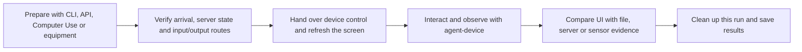

# QA workflow candidates using other tools

Author: JunyoungJung · 2026-10-23 · agent-device version checked: 0.21.30

[한국어](workflow-extensions.md) · [Operations reference](operations.en.md) · [README](../README.en.md)

Other tools can prepare conditions that `agent-device` does not create, then hand off to app interaction and observation. One example is using Mac Computer Use to AirDrop a sample image to an iPhone, then using `agent-device` to exercise the app's photo import.

**These are candidates discoverable from the skill, not verified executable flows.** Official documentation and installed CLI help were checked on 2026-10-23. Keep the documentation investigation separate from subsequent device trials: preparing fixtures in system apps does not establish product-app import or server processing. QR and acoustic tests are proposed experiments based on the tool contracts below.

## Connecting the tools

Prefer existing CLIs and APIs for preparation; use the host's actual Computer Use tools for GUI steps such as Finder and sharing menus. The name Claude or Codex does not establish native-app control: check exposed tools and permissions. Let `agent-device` run the app's user path after observing that preparation completed.

Preparation that bypasses a real input path narrows the claim. Copying into an app container does not establish that the photo picker or photo permission flow passed.

## Ten candidate workflows

These IDs identify research candidates, not `verified` entries in a project flow catalog. Every combination remains unverified on the target app and device until executed there.

| ID | Goal | Tools and sequence | Independent result to check |
|---|---|---|---|
| WF-01 | Import photos, video, or PDFs | Mac Computer Use sends AirDrop → verify destination → agent-device selects through the app's picker | Imported content, orientation, dimensions, and stored result |
| WF-02 | Prepare iPhone/iPad files and photos | iPhone Mirroring on supported devices, Finder USB File Sharing, or Safari download → verify Files/Photos arrival → open in app | Actual destination and import path used |
| WF-03 | Import an Android file | Authorized `adb push` to a dedicated Download path → system document picker → app preview/save | File content and saved result; Photo Picker visibility checked separately |
| WF-04 | Reflect server data on mobile | Existing test API or admin web UI creates data → mobile refresh/search → API read-back | Same test record ID, server state, and displayed value |
| WF-05 | Real push and deep-link entry | Project APNs/FCM test sender → select OS notification → inspect destination and server state | Sender acceptance, device receipt, and navigation as separate steps |
| WF-06 | Consistency after slow/broken requests | Test server or Toxiproxy → retry/cancel/return with agent-device → inspect server/files | Duplicate writes, partial files, and false success indicators |
| WF-07 | Real camera QR/OCR input | Display a known card on a monitor or printout → app scan UI → compare decoded value | Recognition at the stated distance, light, and size |
| WF-08 | Playback continuity and audible output | USB digital audio or external microphone → app playback/return with agent-device → analyze signal | Separate digital-signal evidence from speaker output |
| WF-09 | Preserve data across an app update | Create data on old build → project-verified update install → rerun the flow | Settings, local data, login, and migration results |
| WF-10 | Web/iPhone/Android synchronization | Mutate data on one client → refresh another → test API read-back | Same record's state/version within an agreed synchronization budget |

## WF-01: AirDrop a sample, then import it

This is an initial candidate for exercising the user's actual photo selection path. Apple documents the Wi-Fi, Bluetooth, and proximity requirements; automatic acceptance between devices on the same Apple Account; and varying save destinations. A USB connection alone does not establish AirDrop readiness. [1]

1. **Identify the sample.** Give the synthetic image, video, or PDF a run ID; record filename, MIME, size, SHA-256, and expected content. Put a visible marker in images too, because Photos may not expose the filename.
2. **Send from the Mac.** Use Computer Use in Finder, Preview, or Photos to open sharing/AirDrop, confirm the specified recipient device, and send. Do not guess between devices with the same display name.
3. **Verify receipt and destination.** Handle receipt when needed and locate this sample in Photos or Files. The same Apple Account can accept it without a dialog. The sender's completion indicator does not establish where it landed.
4. **Hand over control.** Finish the Mac transfer actions, then confirm the target app, device, and current screen with `agent-device`. Verify accessibility and screen behavior for receipt, Photos, and Files on that actual device.
5. **Select through the app.** Open its photo or document import and select the identified sample. If it landed in Files, check whether a separate user action can save it to Photos, or choose another preparation route suitable for the test.
6. **Check app processing.** Exercise the requested preview, rotation, crop, cancellation, reselection, save, and re-entry checks. For upload tests, read the result back through the test API.
7. **Clean up.** Within the authorized scope, remove only this run's Photos/Files and app/server items and record restoration. Do not empty the whole library, Downloads, or Recently Deleted.

The gates are **transfer complete → sample found on device → selected in picker → app processing complete → required persistence confirmed**. Separate failures at each gate so a transfer problem is not reported as an app import defect.

Photo sharing or import may transform format or metadata. Define whether the test expects identical bytes or a particular transformation of size/orientation. A screen observation alone does not establish preservation of the original hash.

Separate photo selection from library authorization. A system picker can select photos without granting the app full-library access; identify the app's actual picker/PhotoKit path before defining permission scenarios. Selecting an image does not establish coverage of full or limited library authorization. [13]

## WF-02/03: Choose the file's destination first

| Preparation route | Destination and prerequisites | Scope and limits |
|---|---|---|
| AirDrop | Observed location such as Photos or Files | Can prepare photo/document selection, but verify destination and receipt UI on the device [1] |
| iPhone Mirroring drag/drop | A supported iPhone app or Files | Requires macOS 15+ on Apple silicon/T2, iOS 18+ iPhone, same Apple Account/2FA, connectivity, and regional support. Verify cross-window drag in the host and file drop support. Not an iPad route [2] |
| Finder USB File Sharing | Shared documents of an app that supports File Sharing | Does not seed the whole Photos library. Check how the target app exposes documents in Files [3] |
| Safari download | Files Downloads according to settings, or a destination chosen in the share sheet | Needs a device-reachable URL; HTTPS needs valid TLS. A local HTTP trial serving only non-sensitive synthetic fixtures does not validate a product app's ATS/network policy. Device `localhost` is not the Mac; downloading is not saving into Photos [4] |
| `devicectl device copy to` | An accessible target app container | Check installed `appDataContainer`/bundle ID help and target access. Claim an internal-file test, not an external picker or Photos test [5] |
| Existing Appium `pushFile` | Supported app's `documents` | Real devices require File Sharing and other preparation. Choose only when already prepared; hand over control between XCTest/WDA and agent-device [6] |
| `adb push` | Accessible Android shared storage | Can prepare SAF selection; copying alone does not guarantee MediaStore/Photo Picker indexing [7] |
| `simctl addmedia` | Simulator photo/video library | Fast preliminary testing, not physical-device injection or physical-device evidence [5] |

When the host cannot control an AirDrop window, try **temporary web server serving synthetic fixtures only → device Safari → Save Image in the share sheet → open in Photos**. **Save to Files → open in local Files** is a separate branch. Serve only the fixture directory, bind to a Mac address reachable from the device, and stop the server after testing. Compare an embedded unique marker when names or encoding change; do not claim original-byte preservation without exporting and comparing hashes.

After preparation through iPhone Mirroring, end mirroring and recheck the physical device's lock, screen, and audio route. Mirroring can play iPhone audio on the Mac and does not expose its camera or microphone; do not use that state as the physical speaker/camera test condition. [2]

## WF-04/10: Create on the web, compare on mobile and server

Use an existing test API contract, or an already authorized admin web interface through browser tools. For example, create an announcement, product, favorite, or learning item with a unique test ID, read or change it on mobile, then read the same record from another client and the API.

Bind the record ID, state, and version to the UI text. For asynchronous reflection, establish the project's deadline and completion condition first; do not extend the deadline to turn a late update into a pass. If a mutation's result is uncertain, query the same ID before resending it.

Do not invent a generic write API for a project that has none. Server/admin mutations must stay within the authorized environment and actions. Record this run's IDs and permitted cleanup route. [8]

## WF-05: Separate synthetic events from real push

Use the project's test sender or APNs/FCM route for physical-device delivery. Check notification display/selection with `agent-device` only when the current UI is exposed in a readable, actionable surface. Otherwise hand over to prepared iPhone Mirroring/Computer Use or manual observation, then recheck the destination app screen. Prepare the installed build's environment, notification permission, registration token, and unique test ID; omit tokens and sender credentials from reports. FCM sends to documented targets such as registration tokens. [8], [9]

- `agent-device push` targets iOS simulators, while Android sends a specified broadcast. Neither establishes actual APNs/FCM delivery.
- `trigger-app-event` requires the app's documented deep-link hook and payload contract. It can exercise an internal branch but does not generate an OS notification or real user screenshot event.
- Keep direct `open <url>` navigation separate from selecting an OS notification to reach that destination. [8]

Distinguish background, no running process, and user force-quit states. FCM documents reopening requirements for iOS background messages after swiping the app away, and for Android messages after Force stop in device settings. Do not equate Android removal from Recents with settings Force stop, or group these states into an ordinary background-delivery expectation. [9]

## WF-06: Check data consistency after failure and retry

A **test server** supplies specified error, delayed, or partial responses; **Toxiproxy** changes latency, bandwidth, or connection health for TCP traffic actually routed through it. Starting a host tool alone does not change physical-device traffic when the app is not configured for the test endpoint or proxy. [10]

On Android, `adb reverse` connects a physical USB device's selected localhost port to a host test server. On iPhone, establish a reachable server address, valid TLS, and compatible app network policy. If HTTPS interception is necessary, review existing test-build trust; do not disable release validation or pinning. Passing TLS through a TCP proxy does not itself require decryption. [11]

One experiment is **submit → server accepts but response disconnects → app retries → read back count and final state for the same test ID**. For downloads, verify size/hash and actual opening or offline use after interruption/resumption, beyond the completion indicator.

Do not extend Toxiproxy's TCP coverage to UDP/QUIC/HTTP3, the entire cellular network, or unrelated third-party SDK connections. Remove only this run's toxics, proxy, and port mapping; restore the app endpoint and changed settings. [10], [11]

## WF-07/08: Bring physical input and output into the experiment

| Test | Proposed setup | Evidence and remaining limit |
|---|---|---|
| Camera QR/OCR | A predecoded card or monitor image at a fixed position; drive the app's scan UI | Camera → recognizer → app value under the stated conditions; not all distances, lighting, reflection, or motion |
| iPhone USB digital audio | Check that prepared Audio MIDI Setup can expose the phone as input, then record that input with FFmpeg AVFoundation or equivalent | Signal and gaps on that USB route; not speaker, Bluetooth, or call quality [12] |
| Physical speaker output | Fix device and external microphone/interface positions; record known audio and compare waveform, intervals, and signal | Acoustic output at stated volume, distance, and noise; digital level alone does not establish audible quality |

QR/OCR and external-microphone setups are proposed experiments. Calibrate fixture truth, permissions, placement, route, mute/volume, and timing first. Do not claim actual sound or camera input from agent-device capture alone. Vibration, physical buttons, and cable insertion still need a person or additional fixture.

## WF-09: Distinguish update installation from reset

Create uniquely identified data, settings, and needed login state on the old build, then use a **project-verified data-preserving update procedure** and check the same data on the new build. Bind before/after app identity, signing, version, executable, and data state. Official documentation describes `agent-device install` as an update candidate without prior uninstall, preserving data where the platform allows. Android `adb install -r` also provides data-preserving installation. Neither is an absolute guarantee: check the installed version, backend, app identity, signing, and version conditions, then read back actual data. [7], [8]

Official agent-device command documentation describes `reinstall` as uninstall followed by install for a fresh state. The installed CLI's shorter wording about app identity is **not a data-preservation guarantee**. Using `reinstall` or data clearing in a migration test can destroy the setup. Do not assume downgrade or rollback support either. [8]

## Promoting a candidate into a reusable flow

Use existing project tools and the [flow catalog](../skills/mobile-device-qa/references/reusable-flows.md) before adding wrappers, persistent services, or scenario converters. A successful combination needs more than an executable file:

- Goal, expected result, any bypassed input path, and resulting scope.
- App/build/physical device, host tools and versions, required signing, permissions, account, and endpoint.
- Fixture ID, original hash/MIME/size, server record/event ID, and observed destination.
- Accepted action versus completed result at each step; UI, read-back, file/audio evidence; timings, retries, and partial execution.
- Created items, authorized cleanup and setting restoration, and any remaining resources.

Do not let CUA, agent-device, and Appium input into one device concurrently. Sequence Mac sending, device receipt, and app interaction through gates. After Mirroring or another XCTest runner, hand over control and recheck lock and screen. Installed `agent-device takeover` is for a remote lease, not a general lock for local workflows.

Without execution/device evidence, keep a `draft` candidate. Declare when a shortcut bypasses a picker, mirroring/USB recording changes audio routing, or a test endpoint replaces the real SDK path. These combinations still do not bypass OS security, DRM, or real biometrics, or establish completion of unobservable internal work.

## Order for the first trials

1. **One AirDrop sample → target app import → save and re-enter:** finish the user's example on a small scope, verifying destination, picker, and cleanup.
2. **One Android file → SAF selection → app result:** use prepared ADB and establish the boundary between file injection and processing.
3. **One existing test-API record → mobile reflection → API read-back:** separate server success from screen success.
4. Then prepare the network, real push, camera, or audio checks the project needs. Complete any required app hook, equipment, signing, or test server preparation first.

## System-app trial on 2026-10-23

The connected physical devices were handed over serially using `agent-device` 0.21.30. Codex used the current session; Claude used the actual Claude Code 2.1.301 CLI. Each used a separately marked synthetic PNG. Devices were an iPad 8th generation on iPadOS 26.0.1 and a Galaxy S20 Ultra on Android 13.

| Scope actually observed | Codex | Claude |
|---|---|---|
| Galaxy: `adb push` → compare device hash → browse and open in the system file app | Pass | Pass |
| iPad: local URL → Safari share-sheet Save Image → open that image in Photos | Pass | Pass |
| Mac AirDrop → receipt on the specified iPad | Unverified: Mac UI tool timed out | Unverified: this CLI exposed no native Mac Computer Use tool |
| Product-app photo/document picker, import, and server processing | Outside this trial | Outside this trial |

Claude's iPad run reused the fixture and temporary server prepared by Codex, then performed its own image save and open. Files arrival and preview were recorded separately from Photos in the local QA report. Accessibility-tree/viewport errors in iPad share sheets required screenshots and coordinate actions. Opening the Galaxy file app does not test SAF or Photo Picker.

These are preliminary results for those system apps, devices, and conditions. No WF candidate was promoted to a `verified` catalog flow because replay and usage contracts were not validated. Screenshots, actual recordings, and failure history are retained as local QA artifacts.

## Sources

[1] Apple, [AirDrop](https://support.apple.com/en-gb/guide/mac-help/-mh35868/mac). Connectivity, automatic acceptance on the same Apple Account, and destination behavior.

[2] Apple, [iPhone Mirroring](https://support.apple.com/en-us/120421). Requirements, drag/drop, ending a connection, audio/camera/microphone limits. Recheck current OS and regional support before execution.

[3] Apple, [Finder File Sharing](https://support.apple.com/en-us/119585). USB transfer to apps supporting File Sharing.

[4] Apple, [iPhone/iPad downloads](https://support.apple.com/en-us/102440) and [ATS](https://developer.apple.com/documentation/security/preventing-insecure-network-connections). Files Downloads and app network policy.

[5] Apple, [Xcode command-line tools](https://developer.apple.com/documentation/xcode/xcode-command-line-tool-reference), plus installed Xcode 26.6 `devicectl help device copy to` and `simctl help addmedia`. Container copy and Simulator library preparation contracts.

[6] Appium, [XCUITest file transfer](https://appium.github.io/appium-xcuitest-driver/latest/guides/file-transfer/). Real-device `documents` and File Sharing conditions; an option for an already prepared environment.

[7] Android, [ADB](https://developer.android.com/tools/adb), [Storage Access Framework](https://developer.android.com/training/data-storage/shared/documents-files), and [shared media](https://developer.android.com/training/data-storage/shared/media). Distinct file-copy, preserving-install, document-selection, and media-storage contracts.

[8] Callstack, [Commands](https://oss.callstack.com/agent-device/docs/commands), [Debugging & Profiling](https://oss.callstack.com/agent-device/docs/debugging-profiling), and installed CLI 0.21.30 `help trigger-app-event`, `help push`, `help takeover`, `help reinstall`. Where main documentation and installed help differ, verify support rather than infer data preservation.

[9] Firebase, [Admin SDK sending](https://firebase.google.com/docs/cloud-messaging/send/admin-sdk) and [receipt prerequisites/app states](https://firebase.google.com/docs/cloud-messaging/flutter/receive-messages). Check the project's contract separately for direct APNs sending.

[10] Shopify, [Toxiproxy](https://github.com/Shopify/toxiproxy). Fault injection on selected TCP routes. Checked `ctx7 library` → `ctx7 docs /shopify/toxiproxy` against the official README.

[11] Android, [local servers and adb reverse](https://developer.android.com/develop/ui/views/layout/webapps/access-local-server), [Network Security Configuration](https://developer.android.com/privacy-and-security/security-config). Physical USB devices and debug-only trust.

[12] Appium, [Audio Capture real-device preparation](https://appium.github.io/appium-xcuitest-driver/latest/guides/audio-capture/), and FFmpeg, [AVFoundation input](https://ffmpeg.org/ffmpeg-devices.html#avfoundation). Confirm input availability and actual routing on the current Mac/iPhone. This proposal does not require installing a new Appium server.

[13] Apple, [Selecting Photos and Videos in iOS](https://developer.apple.com/documentation/photokit/selecting-photos-and-videos-in-ios). System picker use and app library authorization are separate test subjects.
