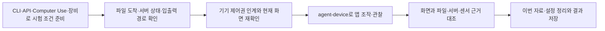

# 다른 도구와 조합하는 QA 워크플로우 후보

Author: JunyoungJung · 2026-10-23 · agent-device 확인 버전: 0.21.30

[English](workflow-extensions.en.md) · [운영 레퍼런스](operations.md) · [README](../README.md)

`agent-device`가 직접 만들지 못하는 시험 조건은 다른 도구로 준비하고, 앱 조작과 결과 관찰을 연결할 수 있습니다. 예를 들어 Mac의 Computer Use로 샘플 이미지를 iPhone에 AirDrop하고, `agent-device`로 앱의 사진 가져오기를 시험하는 방식입니다.

**이 문서는 스킬에서 검색할 수 있는 확장 후보이며, 검증된 자동 실행 흐름은 아닙니다.** 공식 문서와 설치 CLI 도움말을 2026-10-23에 대조했습니다. 문서 조사와 후속 실기기 실증을 구분하며, 기본 앱에서 시험 자료를 준비한 결과를 제품 앱의 가져오기·서버 처리 통과로 확대하지 않습니다. QR·음향 시험은 아래 도구 계약을 바탕으로 제안한 실험 방법입니다.

## 도구를 연결하는 방법

준비 작업은 기존 CLI·API를 우선 사용하고, Finder·공유 메뉴처럼 GUI가 필요한 곳은 현재 호스트가 제공하는 Computer Use로 조작합니다. Claude·Codex라는 이름만으로 native app 제어가 가능하다고 가정하지 않고 실제 도구·권한을 확인합니다. 준비 결과가 관찰된 뒤 `agent-device`가 앱의 사용자 경로를 실행합니다.

준비가 앱의 실제 입력 경로를 건너뛰면 검증 범위도 좁아집니다. 앱 컨테이너에 파일을 복사한 결과로 사진 선택창이나 사진 접근 권한까지 통과했다고 보고하지 않습니다.

## 확장할 수 있는 열 가지 흐름

아래 ID는 조사 후보를 가리킵니다. 기존 프로젝트 흐름 카탈로그의 `verified` ID가 아닙니다. 각 조합은 대상 앱·기기에서 실행하기 전까지 실증 미완료입니다.

| ID | 확인하고 싶은 것 | 연결하는 도구와 흐름 | 별도로 확인할 결과 |
|---|---|---|---|
| WF-01 | 사진·영상·PDF 가져오기 | Mac Computer Use로 AirDrop → 수신 위치 확인 → agent-device로 앱의 picker 선택 | 가져온 자료의 내용·방향·크기·앱 저장 결과 |
| WF-02 | iPhone·iPad의 파일·사진 준비 | 지원 기기의 iPhone Mirroring, Finder USB 파일 공유 또는 Safari 다운로드 → Files·Photos 도착 확인 → 앱에서 열기 | 파일 준비 위치와 실제 사용한 import 경로 |
| WF-03 | Android 파일 가져오기 | 승인된 `adb push`로 전용 Download 경로에 배치 → 시스템 문서 선택창 → 앱 preview·저장 | 파일 내용과 저장 결과. Photo Picker 노출은 별도 확인 |
| WF-04 | 서버 자료의 모바일 반영 | 기존 테스트 API 또는 관리자 웹 UI로 자료 생성 → 모바일 검색·새로고침 → API 재조회 | 같은 테스트 ID의 서버 상태와 화면 값 |
| WF-05 | 실제 푸시와 딥링크 진입 | 프로젝트의 APNs/FCM 시험 발송 → OS 알림 선택 → 모바일 도착 화면·서버 재조회 | 발송 수락, 기기 수신, 화면 진입을 각각 구분 |
| WF-06 | 느린 통신·중단·재시도의 일관성 | 테스트 서버 또는 Toxiproxy → agent-device로 재시도·취소·복귀 → 서버/파일 확인 | 중복 저장, 부분 파일, 잘못된 성공 표시 유무 |
| WF-07 | 실제 카메라의 QR·OCR 입력 | 모니터·출력물에 알려진 시험 카드 제시 → 앱 스캔 UI → 결과 값 대조 | 선언한 거리·조도·크기의 카드 인식 결과 |
| WF-08 | 재생 소리의 연속성과 실제 출력 | USB 디지털 오디오 또는 외부 마이크로 수집 → agent-device로 재생·복귀 → 신호 분석 | 디지털 신호와 실제 스피커 소리를 구분한 근거 |
| WF-09 | 앱 업데이트 후 자료 유지 | 이전 빌드에서 자료 생성 → 프로젝트가 검증한 업데이트 설치 → 같은 흐름 재실행 | 설정·로컬 자료·로그인·마이그레이션 결과 |
| WF-10 | 웹·iPhone·Android 간 동기화 | 한 클라이언트에서 자료 변경 → 다른 클라이언트 갱신 → 테스트 API 재조회 | 같은 레코드의 상태·버전과 합의한 동기화 기한 |

## WF-01: AirDrop으로 샘플을 넣고 앱에서 가져오기

사용자의 실제 사진 선택 경로를 시험할 때 먼저 시도할 후보입니다. Apple은 AirDrop의 Wi‑Fi·Bluetooth·근거리 조건, 같은 Apple Account 기기 사이의 자동 수신, 자료 종류에 따른 저장 위치를 설명합니다. USB로 연결되어 있다는 사실만으로 AirDrop 준비가 끝난 것은 아닙니다. [1]

1. **샘플 식별:** 합성 이미지·영상·PDF에 이번 실행의 식별자를 붙이고 파일명·MIME·크기·SHA-256·기대 내용을 기록합니다. 사진 앱에서 파일명이 보이지 않을 수 있으므로 이미지 자체에도 구별할 표식을 넣습니다.
2. **Mac에서 전송:** Computer Use로 Finder·미리보기·사진 앱의 공유/AirDrop을 열고 지정한 수신 기기를 확인해 보냅니다. 동명이 기기를 추측해 선택하지 않습니다.
3. **수신과 도착 확인:** 필요하면 기기에서 수신을 처리하고 Photos 또는 Files에서 이번 샘플을 확인합니다. 같은 Apple Account면 수락 창 없이 저장될 수 있습니다. 송신 창의 완료 표시만으로 도착 위치를 단정하지 않습니다.
4. **제어권 인계:** Mac의 전송 조작을 끝낸 뒤 `agent-device`에서 대상 앱·기기·현재 화면을 확인합니다. 수신·Photos·Files UI가 해당 기기에서 조작되는지는 실제 접근성 트리와 화면으로 확인합니다.
5. **앱에서 선택:** 대상 앱의 사진 또는 파일 가져오기를 열어 식별한 샘플을 고릅니다. 파일이 Files에 도착했다면 이를 Photos에 저장하는 별도 사용자 경로가 가능한지 확인하거나, 목적에 맞는 다른 준비 경로를 선택합니다.
6. **앱 처리 확인:** 미리보기·회전·잘라내기·취소·재선택·저장 후 재진입 중 요청한 항목을 확인합니다. 서버 업로드까지 시험하면 테스트 API로 결과를 재조회합니다.
7. **정리:** 허용된 범위에서 이번에 만든 Photos/Files 자료와 앱·서버 항목만 정리하고 복원 여부를 기록합니다. 전체 사진함·Downloads·최근 삭제된 항목을 비우지 않습니다.

관문은 **전송 완료 → 기기에서 샘플 확인 → picker에서 선택 → 앱 처리 완료 → 필요한 저장 결과 확인**입니다. 어느 단계가 실패했는지 구분하면 AirDrop 실패를 앱 import 결함으로 오인하지 않습니다.

Photos 공유나 앱 import가 형식·메타데이터를 바꿀 수 있습니다. 원본과 바이트가 같아야 하는 시험과, 정해진 크기·방향으로 변환되어야 하는 시험은 기대값을 다르게 정합니다. 화면 확인만으로 원본 해시 보존을 주장하지 않습니다.

사진 선택과 사진 라이브러리 접근 권한도 구분합니다. 시스템 picker를 통한 선택은 앱의 전체 라이브러리 접근 권한 없이 가능할 수 있으므로, 앱이 실제 사용하는 picker·PhotoKit 경로를 확인한 뒤 해당 권한 시나리오를 정합니다. picker에서 사진을 골랐다는 사실만으로 전체·제한 라이브러리 접근을 시험했다고 보고하지 않습니다. [13]

## WF-02·03: 어디에 파일을 넣을지 먼저 고르기

| 준비 경로 | 실제 목적지와 조건 | 검증 범위와 주의점 |
|---|---|---|
| AirDrop | Photos 또는 Files 등 실제 관찰한 위치 | 사진·문서 선택 경로를 준비할 수 있으나 저장 위치와 수신 UI는 기기별 확인 [1] |
| iPhone Mirroring의 드래그 | 지원되는 iPhone 앱 또는 Files | macOS 15+의 Apple silicon/T2 Mac, iOS 18+ iPhone, 같은 Apple Account·2FA·연결 조건과 지역 지원 필요. 사용 호스트의 창 간 드래그와 해당 파일 drop 지원도 확인. iPad 대체 경로는 아님 [2] |
| Finder USB 파일 공유 | File Sharing을 지원하는 앱의 공유 문서 | 앱이 지원해야 하며 Photos 전체에 파일을 넣는 기능이 아님. Files에 노출되는 방식도 대상 앱에서 확인 [3] |
| Safari 다운로드 | 설정에 따른 Files의 Downloads 또는 공유 메뉴에서 지정한 위치 | 기기에서 도달 가능한 URL이 필요하며 HTTPS는 정상 TLS를 사용. 비민감 합성 자료만 제공하는 로컬 HTTP 시험과 제품 앱의 ATS·네트워크 정책 검증은 구분. 기기의 `localhost`는 Mac이 아니며, 다운로드가 곧 Photos 저장은 아님 [4] |
| `devicectl device copy to` | 접근이 허용된 대상 앱 컨테이너 | 설치 도움말의 `appDataContainer`·bundle ID 계약과 대상 앱 접근 조건 확인. Photos나 외부 문서 picker를 거치지 않은 내부 파일 시험으로 범위를 제한 [5] |
| 기존 Appium의 `pushFile` | 지원 앱의 `documents` | 실기기는 File Sharing 조건 등이 필요. 이미 준비된 경우에만 선택하고 별도 XCTest/WDA runner와 agent-device의 제어권을 인계 [6] |
| `adb push` | Android의 접근 가능한 공유 저장소 | SAF로 파일 선택을 시험할 수 있으나 복사만으로 MediaStore·Photo Picker 노출이 보장되지는 않음 [7] |
| `simctl addmedia` | Simulator의 사진·영상 라이브러리 | 빠른 사전 점검용. 실기기에 주입하는 명령이나 실기기 통과 근거로 사용하지 않음 [5] |

AirDrop 창을 제어할 도구가 없으면 **합성 fixture 전용 임시 웹 서버 → 기기 Safari → 공유 메뉴의 이미지 저장 → Photos에서 열기**를 대안으로 시험할 수 있습니다. **파일에 저장 → 로컬 Files에서 열기**는 별도 분기입니다. 서버는 해당 fixture 폴더만 제공하고, 기기에서 접근 가능한 Mac 주소에 바인딩한 뒤 시험 종료 시 중지합니다. 파일명이 바뀌거나 재인코딩될 수 있으므로 이미지 안의 고유 표식도 대조하고, 원본 바이트 보존은 별도 추출·해시 비교 없이는 통과시키지 않습니다.

iPhone Mirroring으로 준비했다면 미러링을 종료하고 실제 기기의 잠금·화면·오디오 경로를 다시 확인한 뒤 다음 구간으로 넘깁니다. 미러링 중에는 iPhone 소리가 Mac으로 나갈 수 있고 카메라·마이크 접근은 제공되지 않으므로, 그 상태를 실기기 스피커·카메라 시험 조건으로 사용하지 않습니다. [2]

## WF-04·10: 웹에서 만들고 모바일과 서버에서 대조하기

기존 테스트 API가 있으면 그 계약을 쓰고, 없다면 이미 허용된 관리자 웹 화면을 브라우저 도구로 조작하는 후보입니다. 예를 들어 공지·상품·즐겨찾기·학습 항목을 고유 테스트 ID로 생성하고, 모바일에서 읽거나 변경한 뒤 다른 클라이언트와 API에서 같은 레코드를 재조회합니다.

화면 문구 외에 레코드 ID·상태·버전을 연결합니다. 반영이 비동기라면 프로젝트가 정한 대기 기한과 완료 조건을 먼저 확인하고, 늦은 반영을 통과시키기 위해 기한을 임의로 늘리지 않습니다. 전송 결과가 불명확하면 생성·변경을 다시 보내기 전에 같은 ID를 조회해 중복을 방지합니다.

API가 제공되지 않은 프로젝트에 범용 쓰기 API가 있는 것처럼 가정하지 않습니다. 서버나 관리자 도구를 통한 자료 변경도 사용자에게 허용된 환경·조작 범위에서만 수행합니다. 이번 실행의 자료 ID와 허용된 정리 경로를 함께 남깁니다. [8]

## WF-05: 가짜 이벤트와 실제 푸시를 나눠 시험하기

실기기 전달 시험은 프로젝트의 시험 발송 도구 또는 APNs/FCM 발송 경로로 수행합니다. 현재 알림 UI가 접근성 트리와 조작 가능한 화면에 노출될 때 `agent-device`로 표시·선택을 확인하고, 지원되지 않으면 조건을 충족한 iPhone Mirroring/Computer Use 또는 수동 관찰로 인계합니다. 알림 선택 뒤에는 앱 화면을 다시 확인합니다. 대상 설치본의 환경·알림 권한·등록 토큰과 고유 시험 ID가 준비되어야 하며 토큰·발송 자격증명은 리포트에 넣지 않습니다. FCM은 문서화된 대상 등록 토큰 등으로 발송합니다. [8], [9]

- `agent-device push`: iOS는 시뮬레이터용이고, Android는 지정 broadcast를 보냅니다. 실제 APNs/FCM 전달 성공의 증거가 아닙니다.
- `trigger-app-event`: 앱이 문서화한 딥링크 hook과 payload 계약이 있어야 합니다. 특정 앱 내부 분기를 시험할 수 있지만 OS 알림·사용자 스크린샷 같은 실제 시스템 사건을 발생시킨 것은 아닙니다.
- `open <url>`로 목적 화면이 열리는 시험과, OS 알림을 탭해 그 화면에 도착하는 시험을 별도 항목으로 둡니다. [8]

백그라운드, 프로세스가 없는 상태, 사용자가 강제 종료한 상태도 구분합니다. FCM은 iOS에서 앱을 쓸어 종료한 뒤 백그라운드 메시지 재개에 재실행이 필요하고, Android에서는 설정의 강제 종료(Force stop) 후 메시지 수신에 재실행이 필요하다고 설명합니다. Android 최근 앱 화면에서 쓸어 제거한 상태와 설정의 Force stop을 같은 것으로 취급하지 않습니다. 수신을 기대할 수 없는 상태를 일반 백그라운드로 묶어 실패 판정하지 않습니다. [9]

## WF-06: 실패한 뒤 재시도해도 자료가 맞는지 보기

**테스트 서버**는 정해진 오류 응답·지연·부분 응답을 만들고, **Toxiproxy**는 실제로 자신을 통과하는 TCP 연결의 지연·대역폭·연결 중단을 조절합니다. 두 도구의 역할을 구분합니다. 앱이 시험 endpoint 또는 proxy를 지나도록 준비되지 않았다면 호스트에서 도구를 켜는 것만으로 실기기 통신이 바뀌지 않습니다. [10]

Android에서는 `adb reverse`로 USB 실기기의 지정 localhost 포트를 호스트 시험 서버로 연결할 수 있습니다. iPhone은 기기에서 도달 가능한 시험 서버 주소와 정상 TLS·앱 네트워크 정책을 확인합니다. HTTPS 내용을 가로채는 구성이 필요하면 기존 시험 빌드의 신뢰 설정을 검토하며, 릴리스 앱의 인증서 검증·pinning을 임의로 해제하지 않습니다. TCP를 통과시키는 것 자체에는 TLS 복호화가 필수인 것은 아닙니다. [11]

예시 시험은 **저장 요청 → 서버 수락 뒤 응답 단절 → 앱 재시도 → 같은 시험 ID의 저장 건수·최종 상태 재조회**입니다. 다운로드라면 중단·재개 뒤 파일 크기·해시·실제 열기/오프라인 사용을 확인합니다. UI의 완료 표시만 보지 않습니다.

Toxiproxy의 TCP 경로로 QUIC/HTTP3 같은 UDP 경로, 실제 이동통신 전체, 제3자 SDK의 다른 연결까지 시험했다고 확대하지 않습니다. 종료할 때 이번 toxic·proxy·port forwarding만 해제하고 앱 endpoint와 변경한 설정을 복원합니다. [10], [11]

## WF-07·08: 화면 밖 입력과 출력을 실험에 넣기

| 시험 | 제안하는 구성 | 확인할 수 있는 것과 남는 한계 |
|---|---|---|
| QR·OCR 카메라 입력 | 미리 해독해 정답을 확인한 카드나 모니터 이미지를 고정 위치에 두고 앱 스캔 UI를 조작 | 카메라 → 인식기 → 앱 값의 연결. 거리·밝기·반사·모션의 모든 실환경을 보장하지 않음 |
| iPhone USB 디지털 오디오 | 준비된 Audio MIDI Setup에서 기기를 입력으로 활성화할 수 있는지 확인하고, FFmpeg AVFoundation 등으로 해당 입력을 수집 | 그 USB 오디오 경로의 신호·끊김. 실제 스피커·Bluetooth 출력·통화 품질의 증거는 아님 [12] |
| 실제 스피커 출력 | 고정한 기기와 외부 마이크/오디오 인터페이스로 알려진 시험 음원을 녹음하고 파형·구간·신호를 대조 | 선언한 볼륨·거리·주변 소음에서 나온 음향. 디지털 레벨만으로 가청 품질 전체를 판정하지 않음 |

QR/OCR와 외부 마이크 구성은 이번 조사에서 제안한 실험입니다. fixture의 정답, 카메라/마이크 권한, 배치·오디오 경로, 음소거·볼륨과 시각 동기화를 먼저 교정해야 합니다. agent-device의 캡처만으로 실제 소리나 카메라 입력을 확인했다고 보고하지 않습니다. 진동·물리적 버튼·케이블 탈착까지 자동화하려면 사람이나 추가 치구가 여전히 필요합니다.

## WF-09: 업데이트 설치와 초기화를 혼동하지 않기

이전 빌드에서 고유 시험 자료·설정·필요한 로그인 상태를 만든 뒤, **프로젝트가 검증한 데이터 유지 업데이트 절차**로 새 빌드를 설치하고 같은 자료를 확인합니다. 설치 전후 앱 식별자·서명·버전·실행 파일과 자료 상태를 묶어 남깁니다. 공식 문서는 `agent-device install`을 uninstall 없이 설치하는 업데이트 후보로 설명하며, 플랫폼이 허용하는 범위에서 자료를 유지합니다. Android의 `adb install -r`도 자료 유지 옵션입니다. 어느 경로든 설치 버전·백엔드·앱 식별자·서명·버전 조건을 확인하고 실제 자료를 재조회해야 하며 절대적인 보존을 보장하지 않습니다. [7], [8]

공식 agent-device 명령 문서는 `reinstall`을 uninstall 후 install하는 초기화 경로로 설명합니다. 설치 CLI의 짧은 도움말에서 같은 앱 정체성을 언급하더라도 **자료 유지의 보장으로 읽지 않습니다.** 업데이트·마이그레이션 시험에 `reinstall`·앱 데이터 삭제를 무심코 사용하면 준비한 자료를 잃을 수 있습니다. 하위 버전 재설치나 롤백도 지원된다고 가정하지 않습니다. [8]

## 실행 후보를 재사용 흐름으로 올릴 때

새 wrapper·상시 서비스·시나리오 변환기를 만들기 전에 기존 프로젝트 도구와 [흐름 카탈로그](../skills/mobile-device-qa/references/reusable-flows.md)를 사용합니다. 처음 성공한 조합은 실행 파일만 저장하지 말고 다음 조건을 함께 남깁니다.

- 목표·기대값, 입력 경로를 우회했는지와 그에 따른 검증 범위.
- 앱·빌드·물리 기기, 호스트 도구·버전, 필요한 서명·권한·계정·endpoint.
- fixture ID·원본 해시·MIME·크기, 서버 레코드/이벤트 ID, 실제 도착 위치.
- 각 단계의 조작 수락과 실제 완료, 화면·독립 재조회·파일·오디오 근거, 시간·재시도·부분 실행.
- 이번 실행이 만든 항목, 허용된 정리·설정 복원 결과와 미완료 자원.

한 기기에 CUA·agent-device·Appium이 동시에 입력하지 않습니다. Mac 전송 → 기기 수신 확인 → 앱 조작을 관문별로 직렬 실행하고, iPhone Mirroring·다른 XCTest runner를 사용했다면 제어권을 넘긴 뒤 현재 화면과 잠금을 재확인합니다. `agent-device takeover`는 설치 버전 기준 원격 lease 인계용이며 로컬 작업의 범용 잠금으로 가정하지 않습니다.

실행·기기 근거가 없으면 `draft` 후보로 유지합니다. 파일을 넣는 지름길이 시스템 picker를 건너뛰거나, 미러링·USB 녹음이 오디오 경로를 바꾸거나, 테스트 endpoint가 실제 SDK 경로를 대체했다면 그 조건을 결과에 명시합니다. OS 보안·DRM·실제 생체인증 우회나 관측할 수 없는 내부 작업의 통과 판정은 이 조합으로도 해결하지 않습니다.

## 첫 실증의 우선순위

1. **AirDrop 샘플 한 장 → 대상 앱 가져오기 → 저장 후 재진입:** 사용자가 제시한 경로를 작은 끝까지 실행해 수신 위치·picker·정리를 확인합니다.
2. **Android 파일 한 개 → SAF 선택 → 앱 결과 대조:** 이미 준비된 ADB를 사용해 파일 주입과 앱 처리의 경계를 확인합니다.
3. **기존 테스트 API의 한 레코드 → 모바일 반영 → API 재조회:** 서버 성공과 화면 성공을 분리합니다.
4. 그 뒤 프로젝트에 필요한 통신 장애·실제 푸시·카메라·오디오 시험을 준비합니다. 앱 hook·새 장비·서명·시험 서버가 필요한 항목은 별도 준비를 먼저 합니다.

## 2026-10-23 기본 앱 실증

`agent-device` 0.21.30으로 연결된 실기기를 직렬 인계해 실행했습니다. Codex는 현재 세션, Claude는 실제 Claude Code 2.1.301 CLI에서 각각 별도 표식의 합성 PNG를 사용했습니다. iPad는 8세대·iPadOS 26.0.1, Galaxy는 S20 Ultra·Android 13입니다.

| 실제 확인한 범위 | Codex | Claude |
|---|---|---|
| Galaxy: `adb push` → 기기 해시 대조 → 기본 파일 앱에서 탐색·이미지 열기 | 통과 | 통과 |
| iPad: 로컬 URL → Safari 공유의 이미지 저장 → Photos에서 해당 이미지 열기 | 통과 | 통과 |
| Mac AirDrop → 지정 iPad 수신 | 미검증: Mac UI 도구 시간 초과 | 미검증: 이번 CLI에 native Mac Computer Use 도구 미제공 |
| 제품 앱의 사진·문서 picker와 가져오기·서버 처리 | 이번 범위 밖 | 이번 범위 밖 |

Claude의 iPad 실행은 Codex가 준비한 fixture와 임시 서버를 재사용하고, 자신의 이미지 저장·열기를 직접 수행했습니다. 파일 앱 도착·미리보기는 Photos 결과와 분리해 로컬 QA 리포트에 기록했습니다. iPad 공유 시트의 접근성 트리·viewport 오류에는 스크린샷과 좌표 조작이 필요했습니다. Galaxy의 파일 앱 열기는 SAF나 Photo Picker 시험이 아닙니다.

이 결과는 해당 기본 앱·기기·실행 조건의 기초 실증입니다. 실행 파일의 재생과 사용 계약을 검증하지 않았으므로 WF 후보를 재사용 카탈로그의 `verified` 흐름으로 승격하지 않았습니다. 스크린샷·실제 녹화·실패 이력은 로컬 QA 산출물로 보존합니다.

## 근거

[1] Apple, [AirDrop으로 가까운 기기에 항목 보내기](https://support.apple.com/en-gb/guide/mac-help/-mh35868/mac). 연결 조건, 같은 Apple Account 자동 수신과 저장 위치.

[2] Apple, [iPhone Mirroring](https://support.apple.com/en-us/120421). 시스템 요구사항, 파일 드래그, 연결 종료, 오디오·카메라·마이크 제약. 대상 OS와 지역의 현재 지원을 실행 전에 확인합니다.

[3] Apple, [Finder 파일 공유](https://support.apple.com/en-us/119585). USB 연결과 File Sharing 지원 앱의 문서 복사.

[4] Apple, [iPhone/iPad 다운로드 위치](https://support.apple.com/en-us/102440) 및 [ATS](https://developer.apple.com/documentation/security/preventing-insecure-network-connections). Files Downloads와 앱 네트워크 정책.

[5] Apple, [Xcode command-line tools](https://developer.apple.com/documentation/xcode/xcode-command-line-tool-reference) 및 설치 Xcode 26.6의 `devicectl help device copy to`, `simctl help addmedia`. 컨테이너 복사와 Simulator 라이브러리 준비의 도움말 계약.

[6] Appium, [XCUITest file transfer](https://appium.github.io/appium-xcuitest-driver/latest/guides/file-transfer/). 실기기 `documents` 경로와 File Sharing 조건. 기존에 준비된 환경의 선택지입니다.

[7] Android, [ADB](https://developer.android.com/tools/adb), [Storage Access Framework](https://developer.android.com/training/data-storage/shared/documents-files), [shared media](https://developer.android.com/training/data-storage/shared/media). 파일 복사·자료 유지 설치·문서 선택·미디어 저장의 서로 다른 계약.

[8] Callstack, [Commands](https://oss.callstack.com/agent-device/docs/commands)와 [Debugging & Profiling](https://oss.callstack.com/agent-device/docs/debugging-profiling), 설치 CLI 0.21.30의 `help trigger-app-event`, `help push`, `help takeover`, `help reinstall`. 공식 main 문서와 설치 도움말이 다르면 정확한 지원을 확인하고, 자료 보존을 추정하지 않습니다.

[9] Firebase, [Admin SDK 발송](https://firebase.google.com/docs/cloud-messaging/send/admin-sdk), [수신 전제와 앱 상태](https://firebase.google.com/docs/cloud-messaging/flutter/receive-messages). 프로젝트의 APNs 직접 발송은 해당 프로젝트 계약을 별도로 확인합니다.

[10] Shopify, [Toxiproxy](https://github.com/Shopify/toxiproxy). 지정 TCP 경로의 장애 주입. `ctx7 library` → `ctx7 docs /shopify/toxiproxy` 결과를 공식 README와 대조했습니다.

[11] Android, [로컬 서버 접근과 adb reverse](https://developer.android.com/develop/ui/views/layout/webapps/access-local-server), [Network Security Configuration](https://developer.android.com/privacy-and-security/security-config). 실제 USB 기기 지원과 debug 전용 신뢰 설정.

[12] Appium, [Audio Capture의 실기기 준비](https://appium.github.io/appium-xcuitest-driver/latest/guides/audio-capture/) 및 FFmpeg, [AVFoundation input](https://ffmpeg.org/ffmpeg-devices.html#avfoundation). 기기 입력 활성화 가능 여부와 실제 오디오 경로는 현재 Mac·iPhone에서 별도 확인해야 합니다. 이 문서는 새 Appium 서버 설치를 요구하지 않습니다.

[13] Apple, [Selecting Photos and Videos in iOS](https://developer.apple.com/documentation/photokit/selecting-photos-and-videos-in-ios). 시스템 picker와 앱의 사진 라이브러리 권한은 서로 다른 검증 대상입니다.
