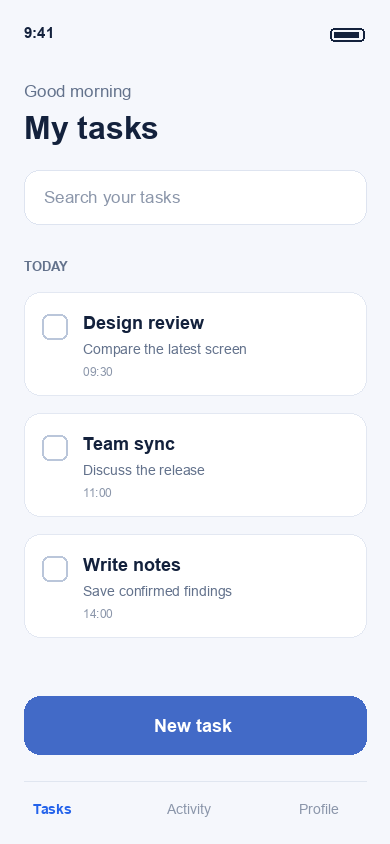
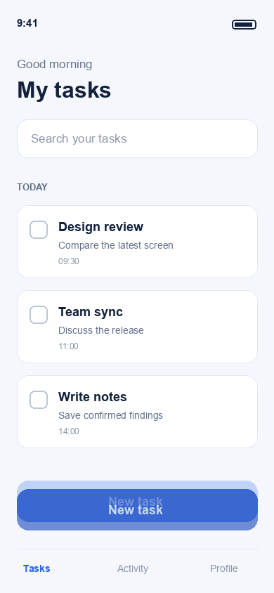
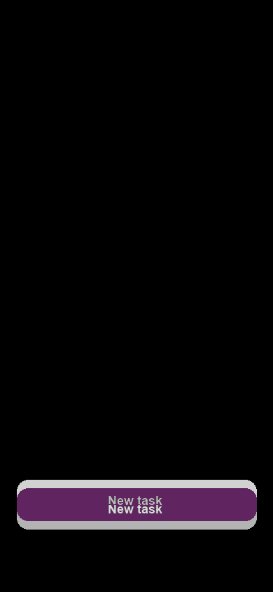
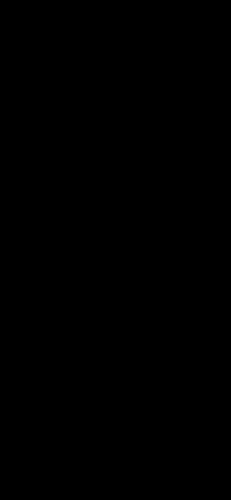

# 픽셀 디자인 검수 결과 예시

Author: JunyoungJung · 2026-10-22

**합성 예시입니다. 실제 앱·Figma·기기 촬영이나 코드 수정·빌드·설치의 결과가 아닙니다.** 가상의 작업 목록 PNG를 만들고 플러그인의 실제 비교 도구로 측정했습니다. `candidate-final.png`는 기준과 같은 조건으로 만든 일치 합성 입력입니다.

[사용 방법으로 돌아가기](../../README.md) · [English guide](../../README.en.md)

## 입력과 비교 범위

표 1은 비교에 사용한 입력 조건입니다. RGBA는 빨강·초록·파랑·투명도 채널을 뜻합니다.

*표 1. 합성 입력과 비교 범위*

| 조건 | 값 |
|---|---|
| 화면 | 가상의 작업 목록, 동일한 텍스트·목록 상태 |
| 입력 | RGB PNG, 390 × 844 px |
| 실제 기기·OS·앱 빌드·Figma node | 해당 없음 — 합성 입력 |
| 논리 화면 크기·기기 배율 | 해당 없음 — 기기 캡처가 아님 |
| 비교 | 원본 크기 유지, 디코딩한 RGBA 픽셀 비교 |
| 색 처리·제외 영역 | 색 변환 없음, 마스크 없음 |

수치는 아래 원본 PNG 전체를 대상으로 계산했습니다.

## 원본 이미지

그림 1의 PNG를 원본 입력으로 사용했습니다. 일치 합성 후보는 완전 일치를 재현하기 위해 기준과 같은 픽셀로 만든 시험 입력입니다.

| 고정 기준 | 불일치 합성 후보 | 일치 합성 후보 |
|---|---|---|
|  |  |  |

*그림 1. 고정 기준과 불일치·일치 합성 후보*

## 겹침으로 위치 확인

겹침(overlay)은 기준 위에 후보를 포갠 이미지입니다. 그림 2에서 같은 위치의 윤곽이 겹치는지 확인합니다. 50% 겹침에서는 이동한 버튼이 이중 윤곽으로 보입니다.

| 25% 겹침 | 50% 겹침 | 75% 겹침 |
|---|---|---|
|  |  |  |

*그림 2. 후보 불투명도가 25%·50%·75%인 겹침*

## 차이와 수치

차이 이미지(diff)는 변경 픽셀을 강조합니다. 그림 3의 밝기는 원래 채널 차이와 같지 않으며, 수치는 표 2의 원본 비교 결과로 확인합니다. [1]–[3]

| 불일치 후보의 차이 | 일치 후보의 차이 |
|---|---|
|  |  |

*그림 3. 불일치 후보와 일치 후보의 차이 이미지*

표 2는 2026-10-22에 실제 비교 구현으로 계산한 JSON의 수치를 옮겼습니다. 색 변환·마스크가 없어 이 예시의 전체 원본 일치(`raw_exact`)와 비교 범위 일치(`compared_exact`) 판정은 같습니다. [1]–[3]

*표 2. 원본 PNG의 픽셀 비교 결과*

| 비교 입력 | 원본 RGBA 완전 일치 | 변경 / 비교 픽셀 | 변경 비율 | 최대 채널 차이 | 평균 절대 오차 | 차이 영역(bbox) |
|---|---|---|---|---|---|---|
| 불일치 합성 후보 | False | 24,106 / 329,160 | 7.3235% | 219 | 3.4113 | `[24, 684, 367, 755]` |
| 일치 합성 후보 | True | 0 / 329,160 | 0.0000% | 0 | 0.0000 | `None` |

차이 영역(bbox)은 `[left, top, right_exclusive, bottom_exclusive]` 형식의 원본 픽셀 좌표이며, 오른쪽·아래쪽 경계는 영역에 포함하지 않습니다. 이는 차이의 범위이며 코드 원인을 추정하는 값은 아닙니다.

표 3은 합성 입력에서 확인한 원인과 실제 프로젝트에서 필요한 확인을 구분합니다.

*표 3. 예시의 불일치와 실제 QA 후속 작업*

| 항목 | 관찰 | 예시에서 확인한 원인 | 실제 프로젝트에서 필요한 후속 작업 |
|---|---|---|---|
| DESIGN-01 | 하단 버튼의 윤곽이 겹치지 않음 | 합성 입력에서 버튼을 아래로 12 px 이동 | 레이아웃 원천 코드를 확인하고 승인된 범위에서 수정 후 재촬영 |
| DESIGN-02 | 버튼의 색이 다름 | 합성 입력에 서로 다른 RGB 색 지정 | 디자인 토큰·색상·테마를 확인하고 같은 조건에서 재검증 |

[불일치 비교 JSON](before/comparison.json) · [일치 비교 JSON](final/comparison.json) · [불일치 마스크](before/mismatch-mask.png)

JSON의 수치·입력 해시(hash)는 실제 비교 결과입니다. 파일 경로만 이 리포트 폴더 기준의 상대 경로로 바꿨습니다. 검정색 최종 diff는 이 합성 PNG들이 같은 픽셀이라는 뜻이며 기능·접근성·실기기 동작의 통과를 뜻하지 않습니다. 비교 명령의 종료 코드 0도 픽셀 일치 판정은 아닙니다.

## 직접 비교 실행

플러그인 루트에서 실행합니다. 먼저 setup을 완료하고 `QA_RUN_DIR`을 선택한 저장 폴더 안의 이번 실행 폴더로 지정합니다. 내장·외장 저장소 중 선택한 위치를 사용하되 프로젝트·호스트의 추가 저장 정책을 따릅니다.

출력 폴더는 새 경로나 비어 있는 폴더여야 합니다. 단독 비교 CLI 자체는 저장소 설정을 읽지 않으므로 아래 공통 저장소 검사를 실행 직전에 수행합니다. 연결 해제·UUID 불일치·선택 범위 이탈 시 이 검사에서 중단하고, 저장소 연결을 유지한 상태에서만 비교합니다.

괄호 안의 별도 셸은 검사 실패 시 뒤의 비교 명령도 실행하지 않습니다.

```bash
(
set -e
python3 -B - "$QA_RUN_DIR/demo-before" "$QA_RUN_DIR/demo-final" <<'PY'
import sys
from mobile_qa.storage import verify_output

for output in sys.argv[1:]:
    verify_output(output)
PY

python3 -B skills/mobile-device-qa/scripts/compare_screenshots.py \
  --reference examples/design-review/reference.png \
  --candidate examples/design-review/candidate-before.png \
  --output-dir "$QA_RUN_DIR/demo-before"

python3 -B skills/mobile-device-qa/scripts/compare_screenshots.py \
  --reference examples/design-review/reference.png \
  --candidate examples/design-review/candidate-final.png \
  --output-dir "$QA_RUN_DIR/demo-final"
)
```

출력 폴더마다 `overlay-25.png`, `overlay-50.png`, `overlay-75.png`, `diff.png`, `mismatch-mask.png`, `comparison.json`을 얻습니다. Markdown 리포트와 실제 조작 GIF는 QA 에이전트가 별도 근거를 검토해 작성·첨부합니다. PNG 비교 명령만으로 보고서·GIF가 자동 생성되지는 않습니다.

## 실제 QA 리포트에서 추가로 받아야 하는 것

실제 기기 모델·OS·앱 빌드, 기준 출처와 버전, 촬영 조건·시점·원본 해시, 최초 수정 전과 최종 변경 빌드의 이미지, 차이별 코드 위치·수정 내용·재검증 결과, 대표 실제 조작 GIF, 미검증 항목과 재검증 조건을 함께 받습니다. 이 예시에는 실제 조작 GIF가 없습니다. 정지 이미지를 이어 붙여 기기 동작처럼 표시하지 않았습니다.

## 참고문헌

[1] Mobile QA, [이미지 비교 구현](../../skills/mobile-device-qa/scripts/compare_screenshots.py) 및 [디자인 검수 절차](../../skills/mobile-device-qa/references/design-review.md). 입력·색 처리·마스크·차이 표시·수치 범위의 근거.

[2] Mobile QA, [불일치 비교 원본 JSON](before/comparison.json). 입력 해시와 변경 픽셀·비율·오차·좌표의 측정 원본.

[3] Mobile QA, [일치 비교 원본 JSON](final/comparison.json). 같은 픽셀로 만든 일치 시험 입력의 측정 원본.
